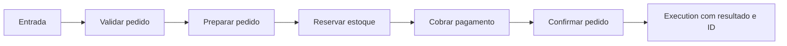
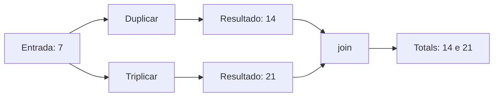
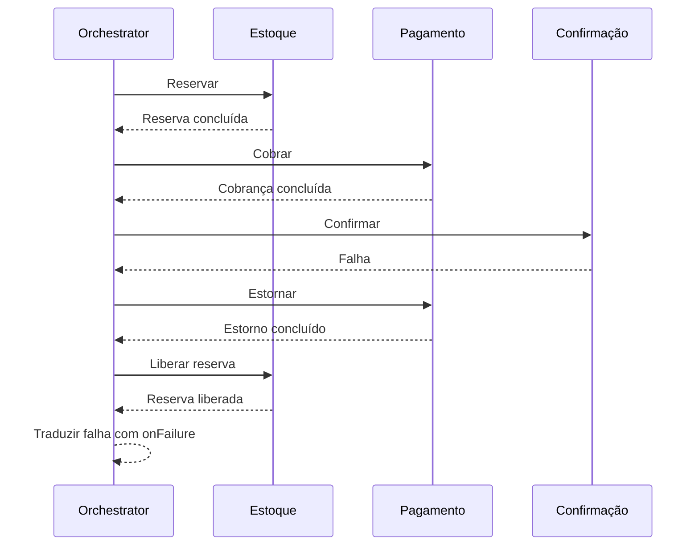
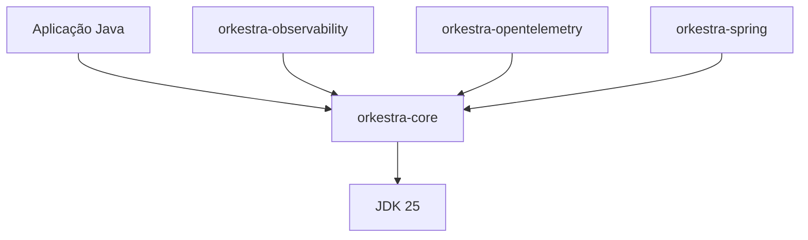

<div align="center">

# Orkestra

**Componha tarefas. Controle a execução. Preserve os tipos.**

Orquestração de tarefas em Java 25, dentro da sua aplicação.

[](https://github.com/Orkestra-java/Orkestra/actions/workflows/build.yml)


[](LICENSE)

[Quando usar](#quando-usar) · [Começar](#começar) · [Recursos](#recursos) · [Exemplos](#exemplos) · [Desenvolvimento](#desenvolvimento) · [Documentação](#documentação)

</div>

Orkestra é uma biblioteca para compor e executar tarefas Java com **sequência,
paralelismo, políticas de execução e compensação**. Um fluxo pode validar um pedido,
consultar serviços em paralelo, reservar estoque e cobrar um pagamento, mantendo
os tipos de entrada e saída em cada etapa.

Você define as operações de negócio; Orkestra coordena sua execução. As composições
são imutáveis e reutilizáveis, e o núcleo funciona com `new Orchestrator()`, usando
recursos locais fornecidos pela própria biblioteca.

| | |
| --- | --- |
| Runtime | Java 25, com virtual threads |
| Núcleo | `io.orkestra:orkestra-core`, sem dependências externas em produção |
| Uso | Classpath ou módulo JPMS `io.orkestra.core` |
| Integrações | Logging, OpenTelemetry e Spring em artefatos opcionais |

> **Versão inicial:** `0.1.0-SNAPSHOT`. A API pode mudar antes da primeira release.
> Para usar agora, compile este repositório e instale os artefatos no Maven local.
> O roteiro de publicação de artefatos está no [guia de release](docs/RELEASE.md).

## Quando usar

- **Fluxos de serviço:** encadear validação, enriquecimento e operações de negócio
  com entradas e saídas verificadas pelo compilador.
- **Consultas independentes:** executar tarefas em paralelo e reunir os resultados
  em uma saída tipada.
- **Operações com efeitos externos:** registrar ações explícitas de compensação,
  como liberar uma reserva ou estornar um pagamento após uma falha.
- **Controle de execução:** aplicar prazos, limites de concorrência, retry, cache
  e diagnóstico às tarefas de um fluxo.

A execução acontece dentro do processo da aplicação. O estado de negócio e a
persistência pertencem ao consumidor. Fluxos que precisam sobreviver a reinícios,
replay ou coordenação distribuída exigem infraestrutura além deste núcleo.

## Como funciona



Uma `Task<C, I, O>` recebe contexto `C` e entrada `I`, e produz saída `O`.
Uma `Composition<C, I, O>` combina essas operações. `Orchestrator.perform(...)`
executa a definição e retorna `Execution<O>` quando o fluxo termina com sucesso.
Falhas são lançadas como exceções, com diagnóstico recuperável por `Failures.details(...)`.

## Começar

### 1. Instale a biblioteca localmente

Com JDK 25 instalado:

```sh
git clone https://github.com/Orkestra-java/Orkestra.git
cd Orkestra/java
./mvnw install
```

Se você já clonou o repositório, execute `./mvnw install` no diretório `java/`.

No Windows, use `mvnw.cmd`. O wrapper fornece Maven 3.9.16; o primeiro build
precisa de rede para baixar Maven, plugins e dependências de teste.

### 2. Adicione a dependência ao seu projeto

Configure seu projeto consumidor para Java 25 e adicione ao `pom.xml`:

```xml
<dependency>
    <groupId>io.orkestra</groupId>
    <artifactId>orkestra-core</artifactId>
    <version>0.1.0-SNAPSHOT</version>
</dependency>
```

<details>
<summary>Usando módulos Java (JPMS)</summary>

Adicione ao `module-info.java` da aplicação:

```java
requires io.orkestra.core;
```

O núcleo exige apenas `java.base`. Logging, OpenTelemetry e Spring são
integrações opcionais em artefatos separados.

</details>

### 3. Execute sua primeira composição

Salve o código abaixo como `Main.java` no seu projeto consumidor:

```java
import io.orkestra.core.Orchestrator;
import io.orkestra.core.composition.Compositions;

public class Main {
    record Order(int quantity) {}
    record ValidatedOrder(int quantity) {}
    record Receipt(String customer, int quantity) {}
    record Context(String customer) {}

    public static void main(String[] args) throws Exception {
        var placeOrder = Compositions.<Context, Order>create()
                .named("place-order")
                .perform((context, order) -> {
                    if (order.quantity() <= 0) {
                        throw new IllegalArgumentException("Quantity must be positive");
                    }
                    return new ValidatedOrder(order.quantity());
                })
                .perform((context, order) ->
                        new Receipt(context.customer(), order.quantity()))
                .build();

        try (var orchestrator = new Orchestrator()) {
            var execution = orchestrator.perform(
                    placeOrder, new Context("customer-123"), new Order(2));
            System.out.println(execution.output());
        }
    }
}
```

```text
Receipt[customer=customer-123, quantity=2]
```

O fluxo recebe `Order`, produz `ValidatedOrder` e termina com `Receipt`. Cada
`perform` recebe a saída da etapa anterior, enquanto o mesmo `Context` acompanha
as tarefas. O exemplo valida o pedido e cria um recibo em memória; operações de
estoque e pagamento podem ser fornecidas como tarefas pela aplicação.

`orchestrator.perform(...)` aguarda o resultado e retorna `Execution<Receipt>`.
O `try` fecha os recursos do executor ao sair. Veja também o
[consumidor completo](examples/PlaceOrder.java), com composição reutilizada e
tratamento de falhas.

## Recursos

| Recurso | API | Aplicação |
| --- | --- | --- |
| Sequência e reutilização | `perform`, `Composition` | Encadear tarefas ou composições existentes |
| Paralelismo tipado | `TaskRef`, `parallel`, `join` | Executar ramos e combinar seus resultados |
| Decisões e coleções | `situation`, `forEach`, `require` | Escolher caminhos, processar itens e validar entradas |
| Prazos e capacidade | `within`, `concurrently`, `isolate`, `exclusively` | Limitar duração, concorrência e acesso por chave |
| Retry e circuit breaker | `retry`, `guard` | Repetir falhas selecionadas e proteger operações |
| Cache local | `cache`, `MemoryCache` | Reutilizar resultados com TTL, limite e invalidação |
| Compensação | `withCompensation`, `compensateWith` | Registrar ações para desfazer efeitos após uma falha |
| Diagnóstico e histórico | `onFailure`, `Failures`, `MemoryHistory` | Traduzir falhas e acompanhar execuções |
| Ciclo de vida | `AutoCloseable`, `shutdown` | Encerrar execuções com orçamento e relatório de pendências |

### Paralelismo com resultados tipados

Os ramos recebem a mesma entrada. `join` combina os resultados, acessados pelas
referências das tarefas; ele só executa quando todos os ramos terminam com sucesso.



```java
import io.orkestra.core.composition.Compositions;
import io.orkestra.core.composition.TaskRef;

record Totals(int doubled, int tripled) {}

var doubleValue = TaskRef.<Void, Integer, Integer>of((context, input) -> input * 2);
var tripleValue = TaskRef.<Void, Integer, Integer>of((context, input) -> input * 3);

var composition = Compositions.<Void, Integer>create()
        .parallel(group -> group.concurrently(2)
                .perform(doubleValue)
                .perform(tripleValue))
        .join((context, results) -> new Totals(
                results.get(doubleValue), results.get(tripleValue)))
        .build();
```

Use `orchestrator.perform(composition, null, 7)` para obter os totais do diagrama.

### Compensação de efeitos

Quando uma etapa falha, as ações de compensação das etapas concluídas são
executadas em ordem inversa de conclusão. No fluxo sequencial abaixo, uma falha
na confirmação dispara o estorno e, depois, a liberação da reserva.



Compensação depende de ações explícitas fornecidas pela aplicação. Ela não é uma
transação de banco de dados. Veja o [exemplo completo](examples/WorkflowExample.java),
que registra reserva, cobrança, estorno e liberação.

### Contratos de execução

- `perform(...)` aguarda o resultado; o executor usa virtual threads internamente.
- Composições e políticas são imutáveis. Tarefas, contexto e objetos compartilhados
  precisam suportar a concorrência que a aplicação configura.
- Retry exige um predicado explícito; `upTo(2)` significa **duas tentativas totais**.
- Cache e retry se aplicam a tarefas individuais. Cache armazena somente sucessos.
- `onFailure` traduz a falha uma vez; não retoma o fluxo como sucesso.
- Cancelamento é cooperativo. Trabalho que ignora interrupção pode permanecer
  pendente e impedir compensação segura; diagnóstico e shutdown reportam isso.

O escopo é execução dentro do processo. Persistência durável, retomada após
reinício e coordenação distribuída não fazem parte deste núcleo.
A [especificação](docs/specification.md) detalha os contratos e limites.

## Integrações opcionais

Para instalar também os adaptadores no seu Maven local:

```sh
cd java
./mvnw -Padapters install
```

Adicione o artefato desejado ao `pom.xml` do consumidor com a versão
`0.1.0-SNAPSHOT`. O núcleo pode ser usado sozinho.




| Artefato (`io.orkestra`) | Integração |
| --- | --- |
| `orkestra-core` | Composições, execução e recursos locais |
| `orkestra-observability` | Eventos em JSON usando `java.util.logging` |
| `orkestra-opentelemetry` | Spans usando um `Tracer` configurado pela aplicação |
| `orkestra-spring` | Encerramento coordenado por `SmartLifecycle` |

Os adaptadores usam a mesma versão do núcleo e são adicionados explicitamente
pelo consumidor. Configuração de exporters, SDKs e recursos externos pertence
à aplicação. Consulte o [guia de integrações](docs/EXTENSIONS.md).

## Exemplos

Na raiz do checkout, depois de executar o build:

```sh
scripts/run-examples.sh
```

| Exemplo | Demonstração |
| --- | --- |
| [PlaceOrder.java](examples/PlaceOrder.java) | Encadeamento tipado, composição reutilizada e tradução de falhas |
| [WorkflowExample.java](examples/WorkflowExample.java) | Paralelismo, decisões, retry, cache, histórico e compensação |

<details>
<summary>Saída do exemplo completo</summary>

```text
Confirmed: customer-123
Actions: [reserve, charge, confirm]
Prices: [2, 4, 6]
Failure: TASK_FAILED
Compensated: [reserve, charge, refund, release-reservation]
```

O exemplo também imprime a quantidade de eventos no histórico.
Ele executa um pedido aceito e outro cuja confirmação falha.
A segunda execução verifica a ordem das ações de compensação.

</details>

## Desenvolvimento

Todos os comandos abaixo partem da raiz do repositório:

| Comando | Resultado |
| --- | --- |
| `(cd java && ./mvnw test)` | Executa os testes do núcleo |
| `(cd java && ./mvnw verify)` | Testa e empacota `orkestra-core` |
| `(cd java && ./mvnw -Padapters verify)` | Inclui testes e JARs das três integrações |
| `(cd java && ./mvnw -Padapters install)` | Instala núcleo e adaptadores no Maven local |
| `python3 scripts/check-api.py` | Compara as assinaturas do núcleo com o baseline |
| `python3 scripts/check-api.py --all` | Verifica também os adaptadores, após seu build |

Consulte [validação](docs/VALIDATION.md) para as evidências locais de testes e
empacotamento, e [GitHub Actions](https://github.com/Orkestra-java/Orkestra/actions)
para os resultados de CI de cada commit.

<details>
<summary>Estrutura do repositório</summary>

```text
.
├── java/
│   ├── core/                  # Biblioteca principal: fontes e testes
│   ├── adapters/              # Logging, OpenTelemetry e Spring
│   ├── benchmarks/            # Medições opcionais
│   ├── pom.xml                # Build Maven
│   └── mvnw                   # Maven Wrapper
├── examples/                  # Consumidores executáveis
├── docs/                      # Especificação, guias e decisões
├── api/                       # Baseline das assinaturas públicas
├── scripts/                   # Ferramentas de validação
└── .github/workflows/          # Build e benchmarks
```

O núcleo usa pacotes por responsabilidade em `io.orkestra.core`.
Veja a [organização da biblioteca](docs/ARCHITECTURE.md).

</details>

## Documentação

- [Índice da documentação](docs/README.md) — ponto de entrada para guias e decisões.
- [Especificação](docs/specification.md) — semântica da API e contratos de execução.
- [Integrações](docs/EXTENSIONS.md) — provedores, eventos, telemetria e Spring.
- [Validação](docs/VALIDATION.md) — evidências de testes e empacotamento.
- [Preparação de release](docs/RELEASE.md) — fontes, Javadoc e compatibilidade.
- [Benchmarks](java/benchmarks/README.md) — ferramentas e interpretação das medições.
- [Guia de contribuição](AGENTS.md) — organização, estilo e verificações.

## Contribuição e licença

Antes de alterar contratos públicos, atualize a especificação e os testes
correspondentes. Descreva o comportamento alterado, a motivação e a validação
no pull request. Mudanças no baseline de API devem ser revisadas explicitamente.

Orkestra é distribuída sob a [licença Apache-2.0](LICENSE).
