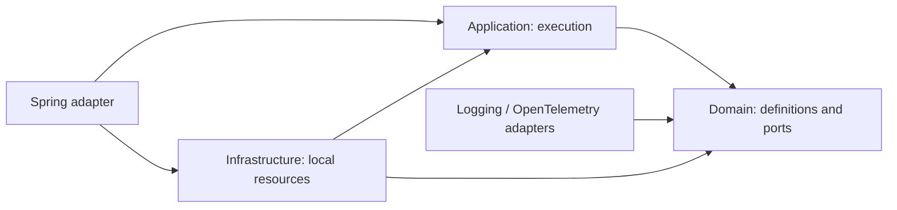

# Architecture

The layout follows TicketHub's separate Maven layers, adapted to an embedded
library. `java/` contains the reactor; repository tools and documentation stay
at the root. The accepted decision is [ADR 0001](adr/0001-layered-library.md).

## Dependency direction

| Layer | Responsibilities | Dependencies |
| --- | --- | --- |
| Domain | immutable composition, typed DSL, task contracts, policies, execution data, exceptions, extension ports | JDK |
| Application | scheduling, deadlines, cancellation, retries, compensation, diagnostics, shutdown | domain, JDK |
| Infrastructure | local resources, memory retention, asynchronous event export, service registration | domain, application, JDK |
| Optional adapters | JUL logging, OpenTelemetry spans, Spring lifecycle | explicit domain/application contracts and the adapter's framework |

## Packages

- `io.orkestra.domain.composition`: definitions, builders, situations, references, joining results.
- `io.orkestra.domain.task`: task, requirement and compensation functions, failure handler.
- `io.orkestra.domain.policy`: immutable retry/cache configuration.
- `io.orkestra.domain.execution`: success/diagnostic/options/shutdown data.
- `io.orkestra.domain.exception`: workflow exceptions.
- `io.orkestra.domain.port`: cache, locks, breaker, events/history, resource factories.
- `io.orkestra.application`: coordinator and execution machinery; implementation classes remain package-private.
- `io.orkestra.infrastructure.{cache,lock,resilience,history,events,resources}`: local implementations.
- `io.orkestra.infrastructure.{logging,opentelemetry,spring}`: optional adapters.

The DSL references the domain's `ExecutionScope` port instead of `Runtime.Frame`.
Its internal node/policy/scope bridge is qualified-exported only to application
under JPMS. `Composition.definition()` exists for this layer bridge and is not a
consumer extension point. Builders and policy configuration remain the public DSL.

## Resource ownership

Application consumes `ResourceProvider`, `CacheStore`, `LockProvider`, and
`CircuitBreaker` interfaces. It never constructs `MemoryCache`, `LocalLocks`,
or `LocalCircuitBreaker`. Infrastructure's `LocalResources` supplies new state
per coordinator and is registered both with JPMS `provides` and classpath
`META-INF/services`. Explicit `Orchestrator.builder().resources(provider)` avoids
service discovery; without a provider, construction fails with an actionable error.

An external provider can implement the ports without changing definitions.
Observability listeners, external SDKs/exporters, and named stores remain owned
by the consuming application. Defaults do not serialize business context.

## Architecture verification

After packaging the reactor, run `python3 scripts/check-architecture.py` from
the repository root. It analyzes compiled class dependencies with JDK `jdeps`,
rejects misplaced types and outward/framework dependencies in inner layers,
and checks JPMS dependencies and the qualified internal export. CI runs this
check separately from workflow behavior and public signature compatibility.
