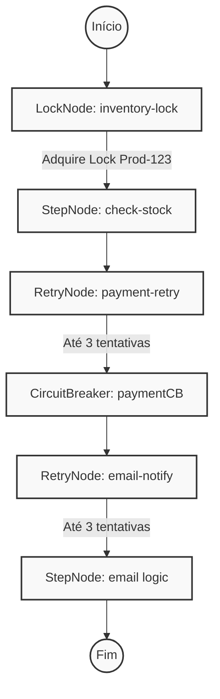

# Orkestra

Biblioteca Java para orquestração de workflows, com DSL fluente, execução paralela, retry, circuit breaker, locks e integração com Spring.

## Sobre este documento

Consolidação dos arquivos textuais do projeto contido em `Codes.rar`. Inclui código-fonte, testes, configurações e documentação original. O conteúdo foi preservado, normalizando apenas as quebras de linha. Metadados Git, configurações da IDE e artefatos de compilação foram excluídos.

**Arquivos incluídos:** 56.

## Índice

- [.gitignore](#arquivo-001)
- [README.md](#arquivo-002)
- [pom.xml](#arquivo-003)
- [src/main/java/io/orkestra/core/context/ExecutionScope.java](#arquivo-004)
- [src/main/java/io/orkestra/core/context/WorkflowContext.java](#arquivo-005)
- [src/main/java/io/orkestra/core/exception/CompensationException.java](#arquivo-006)
- [src/main/java/io/orkestra/core/exception/StepExecutionException.java](#arquivo-007)
- [src/main/java/io/orkestra/core/exception/WorkflowDefinitionException.java](#arquivo-008)
- [src/main/java/io/orkestra/core/exception/WorkflowException.java](#arquivo-009)
- [src/main/java/io/orkestra/core/node/AbstractWorkflowNode.java](#arquivo-010)
- [src/main/java/io/orkestra/core/node/ChoiceNode.java](#arquivo-011)
- [src/main/java/io/orkestra/core/node/CircuitBreakerNode.java](#arquivo-012)
- [src/main/java/io/orkestra/core/node/ConditionalNode.java](#arquivo-013)
- [src/main/java/io/orkestra/core/node/DelayNode.java](#arquivo-014)
- [src/main/java/io/orkestra/core/node/EchoNode.java](#arquivo-015)
- [src/main/java/io/orkestra/core/node/FallbackNode.java](#arquivo-016)
- [src/main/java/io/orkestra/core/node/ForEachNode.java](#arquivo-017)
- [src/main/java/io/orkestra/core/node/LockNode.java](#arquivo-018)
- [src/main/java/io/orkestra/core/node/ManagedStepNode.java](#arquivo-019)
- [src/main/java/io/orkestra/core/node/NodeData.java](#arquivo-020)
- [src/main/java/io/orkestra/core/node/NodeResult.java](#arquivo-021)
- [src/main/java/io/orkestra/core/node/OrchestratedNode.java](#arquivo-022)
- [src/main/java/io/orkestra/core/node/ParallelNode.java](#arquivo-023)
- [src/main/java/io/orkestra/core/node/RetryNode.java](#arquivo-024)
- [src/main/java/io/orkestra/core/node/SequenceNode.java](#arquivo-025)
- [src/main/java/io/orkestra/core/node/StepNode.java](#arquivo-026)
- [src/main/java/io/orkestra/core/node/VoidNode.java](#arquivo-027)
- [src/main/java/io/orkestra/core/node/WorkflowNode.java](#arquivo-028)
- [src/main/java/io/orkestra/core/step/Activity.java](#arquivo-029)
- [src/main/java/io/orkestra/core/step/Step.java](#arquivo-030)
- [src/main/java/io/orkestra/engine/ExecutionResult.java](#arquivo-031)
- [src/main/java/io/orkestra/engine/WorkflowEngine.java](#arquivo-032)
- [src/main/java/io/orkestra/engine/definition/WorkflowDefinition.java](#arquivo-033)
- [src/main/java/io/orkestra/engine/dsl/Workflow.java](#arquivo-034)
- [src/main/java/io/orkestra/engine/dsl/WorkflowBuilder.java](#arquivo-035)
- [src/main/java/io/orkestra/spi/activity/ActivityProvider.java](#arquivo-036)
- [src/main/java/io/orkestra/spi/listener/LoggingWorkflowListener.java](#arquivo-037)
- [src/main/java/io/orkestra/spi/listener/WorkflowListener.java](#arquivo-038)
- [src/main/java/io/orkestra/spi/lock/DistributedLockProvider.java](#arquivo-039)
- [src/main/java/io/orkestra/spi/state/InMemoryStateStore.java](#arquivo-040)
- [src/main/java/io/orkestra/spi/state/StateStore.java](#arquivo-041)
- [src/main/java/io/orkestra/spring/OrkestraAutoConfiguration.java](#arquivo-042)
- [src/main/java/io/orkestra/spring/SpringActivityProvider.java](#arquivo-043)
- [src/main/resources/META-INF/spring/org.springframework.boot.autoconfigure.AutoConfiguration.imports](#arquivo-044)
- [src/test/java/io/orkestra/core/context/WorkflowContextTest.java](#arquivo-045)
- [src/test/java/io/orkestra/core/node/CircuitBreakerNodeTest.java](#arquivo-046)
- [src/test/java/io/orkestra/core/node/EchoNodeTest.java](#arquivo-047)
- [src/test/java/io/orkestra/core/node/FallbackNodeTest.java](#arquivo-048)
- [src/test/java/io/orkestra/core/node/LockNodeTest.java](#arquivo-049)
- [src/test/java/io/orkestra/core/node/NodeTest.java](#arquivo-050)
- [src/test/java/io/orkestra/core/node/RetryNodeTest.java](#arquivo-051)
- [src/test/java/io/orkestra/core/node/VoidNodeTest.java](#arquivo-052)
- [src/test/java/io/orkestra/engine/GlobalExceptionHandlerTest.java](#arquivo-053)
- [src/test/java/io/orkestra/engine/WorkflowEngineIntegrationTest.java](#arquivo-054)
- [src/test/java/io/orkestra/examples/OrderProcessingExample.java](#arquivo-055)
- [src/test/java/io/orkestra/examples/SpringMoneyTransferExample.java](#arquivo-056)

## Conteúdo dos arquivos

<a id="arquivo-001"></a>

### `.gitignore`

```text
target/
*.class
.settings/
.project
.classpath
.factorypath
.idea/
*.iml
*.iws
.DS_Store
```

<a id="arquivo-002"></a>

### `README.md`

````markdown
# Orkestra — The Modern Java Workflow Library

[](https://github.com/MatheusJFA/Orkestra)
[](LICENSE)

Orkestra is a lightweight, resilient, and developer-friendly workflow engine for Java. It allows you to define complex business flows with a fluent DSL, supporting retry logic, delays, distributed locking, and circuit breakers out of the box.

## 🚀 Core Features

- **Fluent DSL**: Define workflows in a readable, type-safe manner.
- **Resilience Patterns**: Built-in support for `retry`, `delay`, and `circuitBreaker`.
- **Synchronization**: Distributed locking support via the `DistributedLockProvider` SPI.
- **Concurrency**: High-performance `parallel` execution with context synchronization.
- **Spring Boot Support**: Seamless integration with Spring's Dependency Injection.

## 📦 Installation (Coming Soon)

```xml
<dependency>
    <groupId>io.orkestra</groupId>
    <artifactId>orkestra</artifactId>
    <version>1.0.0</version>
</dependency>
```

## 🛠️ Real-World Example: Order Processing

Orkestra shines in complex business logic. Here is a professional e-commerce scenario:

```java
var workflow = Workflow.<WorkflowContext, NodeData>create("order-fulfillment")
    // 1. Synchronize inventory access across instances
    .lock("inventory-lock", "prod-123", lock -> {
        lock.step("check-stock", (ctx, data) -> NodeResult.success(data.with("stock_ok", true)));
    })
    
    // 2. Resilient Payment call (Circuit Breaker + Retry)
    .retry("payment-retry", 3, (ctx, data) -> {
        return paymentCB.execute(ctx, data); // Uses a shared CircuitBreakerNode instance
    })
    
    // 3. Flaky Notification with Simple Retry
    .retry("email-notify", 3, (ctx, data) -> {
        // notification logic...
        return NodeResult.success(data.with("notified", true));
    })
    .build();

WorkflowEngine engine = WorkflowEngine.createDefault();
ExecutionResult<NodeData> result = engine.execute(workflow, new WorkflowContext(), NodeData.empty());
```

### 📊 Representação Visual desse Fluxo (Visual Workflow Representation)



## 🧪 Testing Suite

Orkestra is built with a "test-first" mentality. The project includes a comprehensive suite:

- **Unit Tests**: Full coverage for specialized nodes (`RetryNode`, `CircuitBreakerNode`, `LockNode`).
- **Integration Tests**: Verification of full engine execution and DSL semantics.
- **Functional Examples**: Documented business flows like `OrderProcessingExample.java`.

## 📜 License

This project is licensed under the MIT License - see the [LICENSE](LICENSE) file for details.

---
Orkestra is designed to handle the complexity of distributed systems so you can focus on your business logic. 🚀
````

<a id="arquivo-003"></a>

### `pom.xml`

```xml
<?xml version="1.0" encoding="UTF-8"?>
<project xmlns="http://maven.apache.org/POM/4.0.0"
         xmlns:xsi="http://www.w3.org/2001/XMLSchema-instance"
         xsi:schemaLocation="http://maven.apache.org/POM/4.0.0 http://maven.apache.org/xsd/maven-4.0.0.xsd">
    <modelVersion>4.0.0</modelVersion>

    <groupId>io.orkestra</groupId>
    <artifactId>orkestra</artifactId>
    <version>1.0.0-SNAPSHOT</version>

    <name>Orkestra - Workflow Engine</name>
    <description>A lightweight, extensible workflow engine for Java.</description>

    <properties>
        <maven.compiler.source>17</maven.compiler.source>
        <maven.compiler.target>17</maven.compiler.target>
        <project.build.sourceEncoding>UTF-8</project.build.sourceEncoding>
        <junit.version>5.10.2</junit.version>
        <assertj.version>3.25.3</assertj.version>
        <mapstruct.version>1.6.3</mapstruct.version>
        <lombok.version>1.18.30</lombok.version>
        <slf4j.version>2.0.12</slf4j.version>
    </properties>

    <dependencies>
        <!-- Lombok -->
        <dependency>
            <groupId>org.projectlombok</groupId>
            <artifactId>lombok</artifactId>
            <version>${lombok.version}</version>
            <scope>provided</scope>
        </dependency>
        <!-- SLF4J -->
        <dependency>
            <groupId>org.slf4j</groupId>
            <artifactId>slf4j-api</artifactId>
            <version>${slf4j.version}</version>
        </dependency>
        <!-- MapStruct -->
        <dependency>
            <groupId>org.mapstruct</groupId>
            <artifactId>mapstruct</artifactId>
            <version>${mapstruct.version}</version>
        </dependency>

        <!-- Spring Boot (Optional for users who only want core engine) -->
        <dependency>
            <groupId>org.springframework.boot</groupId>
            <artifactId>spring-boot-starter</artifactId>
            <version>3.2.3</version>
            <optional>true</optional>
        </dependency>

        <!-- Testing -->
        <dependency>
            <groupId>org.junit.jupiter</groupId>
            <artifactId>junit-jupiter</artifactId>
            <version>${junit.version}</version>
            <scope>test</scope>
        </dependency>
        <dependency>
            <groupId>org.assertj</groupId>
            <artifactId>assertj-core</artifactId>
            <version>${assertj.version}</version>
            <scope>test</scope>
        </dependency>
        <dependency>
            <groupId>org.springframework.boot</groupId>
            <artifactId>spring-boot-starter-test</artifactId>
            <version>3.2.3</version>
            <scope>test</scope>
        </dependency>
    </dependencies>

    <build>
        <plugins>
            <plugin>
                <groupId>org.apache.maven.plugins</groupId>
                <artifactId>maven-compiler-plugin</artifactId>
                <version>3.12.1</version>
                <configuration>
                    <source>17</source>
                    <target>17</target>
                    <annotationProcessorPaths>
                        <path>
                            <groupId>org.projectlombok</groupId>
                            <artifactId>lombok</artifactId>
                            <version>${lombok.version}</version>
                        </path>
                        <path>
                            <groupId>org.mapstruct</groupId>
                            <artifactId>mapstruct-processor</artifactId>
                            <version>${mapstruct.version}</version>
                        </path>
                    </annotationProcessorPaths>
                </configuration>
            </plugin>
            <plugin>
                <groupId>org.apache.maven.plugins</groupId>
                <artifactId>maven-surefire-plugin</artifactId>
                <version>3.2.5</version>
            </plugin>
        </plugins>
    </build>
</project>
```

<a id="arquivo-004"></a>

### `src/main/java/io/orkestra/core/context/ExecutionScope.java`

```java
package io.orkestra.core.context;

import io.orkestra.core.step.Step;
import io.orkestra.spi.activity.ActivityProvider;
import io.orkestra.spi.lock.DistributedLockProvider;
import io.orkestra.spi.state.StateStore;
import lombok.Getter;

import java.time.Instant;
import java.util.*;

/**
 * <EN> Internal engine state for a single workflow execution.
 * <PT> Estado interno do motor (engine) para uma única execução de workflow.
 */
@Getter
public class ExecutionScope<C> {

    private final String executionId;
    private final Instant startedAt;
    private final C context;
    private final ActivityProvider activityProvider;
    private final DistributedLockProvider lockProvider;
    private final StateStore stateStore;
    private final Deque<CompensationEntry<C>> compensationStack = new ArrayDeque<>();
    private final List<String> executionLog;

    public ExecutionScope(String executionId, C context, ActivityProvider activityProvider, DistributedLockProvider lockProvider, StateStore stateStore, List<String> executionLog) {
        this.executionId = Objects.requireNonNull(executionId);
        this.context = Objects.requireNonNull(context);
        this.activityProvider = Objects.requireNonNull(activityProvider);
        this.lockProvider = lockProvider; // Optional
        this.stateStore = stateStore; // Optional
        this.executionLog = Objects.requireNonNull(executionLog);
        this.startedAt = Instant.now();
    }

    public void log(String message) {
        executionLog.add(String.format("[%s] %s", executionId, message));
    }

    public void pushCompensation(String nodeId, Step<C, ?, ?> step) {
        compensationStack.push(new CompensationEntry<>(nodeId, step));
    }

    public CompensationEntry<C> popCompensation() {
        return compensationStack.poll();
    }

    public boolean hasCompensations() {
        return !compensationStack.isEmpty();
    }

    public Collection<CompensationEntry<C>> getCompensationStack() {
        return Collections.unmodifiableCollection(compensationStack);
    }

    public record CompensationEntry<C>(String nodeId, Step<C, ?, ?> step) {}
}
```

<a id="arquivo-005"></a>

### `src/main/java/io/orkestra/core/context/WorkflowContext.java`

```java
package io.orkestra.core.context;

import java.util.Collections;
import java.util.HashMap;
import java.util.Map;
import java.util.Objects;
import java.util.concurrent.ConcurrentHashMap;

/**
 * Default map-based context for Orkestra workflows.
 * Pure data store, execution state is managed by the engine.
 */
public class WorkflowContext {

    private final ConcurrentHashMap<String, Object> variables = new ConcurrentHashMap<>();

    public WorkflowContext put(String key, Object value) {
        variables.put(Objects.requireNonNull(key), Objects.requireNonNull(value));
        return this;
    }

    @SuppressWarnings("unchecked")
    public <T> T get(String key, Class<T> type) {
        Object value = variables.get(key);
        return value != null ? type.cast(value) : null;
    }

    public boolean contains(String key) {
        return variables.containsKey(key);
    }

    public Map<String, Object> getVariables() {
        return Collections.unmodifiableMap(new HashMap<>(variables));
    }

    @Override
    public String toString() {
        return "WorkflowContext" + variables.keySet();
    }
}
```

<a id="arquivo-006"></a>

### `src/main/java/io/orkestra/core/exception/CompensationException.java`

```java
package io.orkestra.core.exception;

/**
 * Thrown when compensation logic itself fails.
 *
 * <p>
 * This is a critical error — it means the system could not undo
 * previously completed steps. Callers should log this at SEVERE level
 * and potentially trigger manual intervention.
 * </p>
 */
public class CompensationException extends WorkflowException {

    private final int compensatedCount;
    private final int totalToCompensate;

    public CompensationException(String message, Throwable cause,
            int compensatedCount, int totalToCompensate) {
        super(message, cause);
        this.compensatedCount = compensatedCount;
        this.totalToCompensate = totalToCompensate;
    }

    /**
     * @return number of compensations that succeeded before this failure.
     */
    public int getCompensatedCount() {
        return compensatedCount;
    }

    /**
     * @return total number of compensations that were queued.
     */
    public int getTotalToCompensate() {
        return totalToCompensate;
    }
}
```

<a id="arquivo-007"></a>

### `src/main/java/io/orkestra/core/exception/StepExecutionException.java`

```java
package io.orkestra.core.exception;

/**
 * Thrown when a {@link io.orkestra.core.step.Step} fails during execution.
 */
public class StepExecutionException extends WorkflowException {

    private final String stepName;

    public StepExecutionException(String stepName, String message, Throwable cause, String nodeId) {
        super(String.format("Step '%s' failed: %s", stepName, message), cause, nodeId);
        this.stepName = stepName;
    }

    public StepExecutionException(String stepName, Throwable cause, String nodeId) {
        this(stepName, cause.getMessage(), cause, nodeId);
    }

    public String getStepName() {
        return stepName;
    }
}
```

<a id="arquivo-008"></a>

### `src/main/java/io/orkestra/core/exception/WorkflowDefinitionException.java`

```java
package io.orkestra.core.exception;

/**
 * Thrown when a workflow definition is invalid — e.g. missing required
 * nodes, circular references, or invalid configuration.
 */
public class WorkflowDefinitionException extends WorkflowException {

    public WorkflowDefinitionException(String message) {
        super(message);
    }

    public WorkflowDefinitionException(String message, Throwable cause) {
        super(message, cause);
    }
}
```

<a id="arquivo-009"></a>

### `src/main/java/io/orkestra/core/exception/WorkflowException.java`

```java
package io.orkestra.core.exception;

/**
 * Base exception for all workflow-related errors.
 *
 * <p>All exceptions thrown by the framework extend this class, enabling
 * a single catch point for consumers who want to handle any workflow error
 * uniformly.</p>
 */
public class WorkflowException extends RuntimeException {

    private final String nodeId;

    public WorkflowException(String message) {
        this(message, null, null);
    }

    public WorkflowException(String message, Throwable cause) {
        this(message, cause, null);
    }

    public WorkflowException(String message, Throwable cause, String nodeId) {
        super(message, cause);
        this.nodeId = nodeId;
    }

    /**
     * @return the ID of the node where the error originated, or {@code null} if not node-specific.
     */
    public String getNodeId() {
        return nodeId;
    }
}
```

<a id="arquivo-010"></a>

### `src/main/java/io/orkestra/core/node/AbstractWorkflowNode.java`

```java
package io.orkestra.core.node;

import io.orkestra.core.context.ExecutionScope;

import java.util.Objects;
import java.util.UUID;

/**
 * <EN> Base implementation for all workflow nodes handling common infrastructure.
 * <PT> Implementação base para todos os nós de workflow que lidam com a infraestrutura comum.
 */
public abstract class AbstractWorkflowNode<C, I, O> implements WorkflowNode<C, I, O> {

    private final String id;
    protected final String name;

    protected AbstractWorkflowNode(String name) {
        this.id = UUID.randomUUID().toString();
        this.name = Objects.requireNonNull(name, "name must not be null");
    }

    @Override
    public final NodeResult<O> execute(ExecutionScope<C> scope, I input) {
        scope.log(String.format("Starting node: %s (id: %s)", name, id));
        long startTime = System.currentTimeMillis();
        try {
            NodeResult<O> result = doExecute(scope, input);
            long duration = System.currentTimeMillis() - startTime;
            
            if (result.isSuccess()) {
                scope.log(String.format("Node '%s' succeeded in %dms", name, duration));
            } else {
                scope.log(String.format("Node '%s' returned status %s in %dms", name, result.status(), duration));
            }
            
            return result.withIdentity(id, name, duration);
        } catch (Exception e) {
            long duration = System.currentTimeMillis() - startTime;
            scope.log(String.format("Node '%s' FAILED after %dms: %s", name, duration, e.getMessage()));
            return NodeResult.failureOf(id, name, e, duration);
        }
    }

    /**
     * Internal execution logic.
     */
    protected abstract NodeResult<O> doExecute(ExecutionScope<C> scope, I input);

    @Override public String getId() { return id; }
    @Override public String getName() { return name; }

    @Override
    public String toString() {
        return String.format("%s[id=%s, name=%s]", getClass().getSimpleName(), id, name);
    }
}
```

<a id="arquivo-011"></a>

### `src/main/java/io/orkestra/core/node/ChoiceNode.java`

```java
package io.orkestra.core.node;

import io.orkestra.core.context.ExecutionScope;
import lombok.Getter;

import java.util.Map;
import java.util.Objects;
import java.util.function.Function;
 
/**
 * <EN> Multi-branching node (switch/case) based on a value extracted from context or input.
 * <PT> Nó de múltiplas ramificações (tipo switch/case) com base em um valor extraído do contexto ou do input.
 */
@Getter
public class ChoiceNode<C, T, V> extends AbstractWorkflowNode<C, T, T> {
 
    private final Function<T, V> valueExtractor;
    private final Map<V, WorkflowNode<C, T, T>> branches;
    private final WorkflowNode<C, T, T> defaultBranch;
 
    public ChoiceNode(String name, Function<T, V> valueExtractor, Map<V, WorkflowNode<C, T, T>> branches, WorkflowNode<C, T, T> defaultBranch) {
        super(name);
        this.valueExtractor = Objects.requireNonNull(valueExtractor);
        this.branches = Objects.requireNonNull(branches);
        this.defaultBranch = defaultBranch;
    }
 
    @Override
    protected NodeResult<T> doExecute(ExecutionScope<C> scope, T input) {
        V value = valueExtractor.apply(input);
        WorkflowNode<C, T, T> branch = branches.get(value);
 
        if (branch != null) {
            String msg = String.format("Choice node '%s' selected branch: %s", getName(), value);
            scope.log(msg);
            return branch.execute(scope, input);
        } else if (defaultBranch != null) {
            String msg = String.format("Choice node '%s' using default branch for value: %s", getName(), value);
            scope.log(msg);
            return defaultBranch.execute(scope, input);
        }
 
        String msg = String.format("Choice node '%s' no branch matching value: %s - continuing", getName(), value);
        scope.log(msg);
        return NodeResult.success(input);
    }
}
```

<a id="arquivo-012"></a>

### `src/main/java/io/orkestra/core/node/CircuitBreakerNode.java`

```java
package io.orkestra.core.node;

import io.orkestra.core.context.ExecutionScope;
import lombok.Getter;

import java.util.Objects;
import java.util.concurrent.atomic.AtomicInteger;
import java.util.concurrent.atomic.AtomicLong;

/**
 * <EN> A node that implements a Circuit Breaker pattern for lateral calls.
 * <PT> Um nó que implementa o padrão de Circuit Breaker para chamadas laterais/distribuídas.
 */
@Getter
public class CircuitBreakerNode<C, I, O> extends AbstractWorkflowNode<C, I, O> {

    public enum State { CLOSED, OPEN, HALF_OPEN }

    private final WorkflowNode<C, I, O> innerNode;
    private final int failureThreshold;
    private final long resetTimeoutMillis;
    
    private final AtomicInteger failures = new AtomicInteger(0);
    private final AtomicLong lastFailureTime = new AtomicLong(0);
    private volatile State state = State.CLOSED;

    public CircuitBreakerNode(String name, WorkflowNode<C, I, O> innerNode, int failureThreshold, long resetTimeoutMillis) {
        super(name);
        this.innerNode = Objects.requireNonNull(innerNode);
        this.failureThreshold = failureThreshold;
        this.resetTimeoutMillis = resetTimeoutMillis;
    }

    @Override
    protected NodeResult<O> doExecute(ExecutionScope<C> scope, I input) {
        if (state == State.OPEN) {
            long elapsed = System.currentTimeMillis() - lastFailureTime.get();
            if (elapsed > resetTimeoutMillis) {
                synchronized (this) {
                    if (state == State.OPEN) {
                        state = State.HALF_OPEN;
                        String msg = String.format("Circuit breaker '%s' HALF-OPEN, testing...", getName());
                        scope.log(msg);
                    } else if (state == State.HALF_OPEN) {
                        return NodeResult.failure("Circuit breaker is HALF-OPEN (testing in progress)");
                    }
                }
            } else {
                return NodeResult.failure("Circuit breaker is OPEN");
            }
        }

        NodeResult<O> result = innerNode.execute(scope, input);

        if (result.isSuccess()) {
            if (state != State.CLOSED) {
                synchronized (this) {
                    String msg = String.format("Circuit breaker '%s' CLOSED.", getName());
                    scope.log(msg);
                    state = State.CLOSED;
                    failures.set(0);
                }
            }
            return result;
        } else {
            int currentFailures = failures.incrementAndGet();
            lastFailureTime.set(System.currentTimeMillis());
            
            if (state == State.HALF_OPEN || currentFailures >= failureThreshold) {
                synchronized (this) {
                    if (state != State.OPEN) {
                        String msg = String.format("Circuit breaker '%s' OPENED (failures: %d).", getName(), currentFailures);
                        scope.log(msg);
                        state = State.OPEN;
                    }
                }
            }
            return result;
        }
    }
}
```

<a id="arquivo-013"></a>

### `src/main/java/io/orkestra/core/node/ConditionalNode.java`

```java
package io.orkestra.core.node;

import io.orkestra.core.context.ExecutionScope;
import lombok.Getter;

import java.util.Objects;
import java.util.function.Predicate;

/**
 * Routes based on a predicate or a condition node.
 * Strictly binary: executes thenNode if true, elseNode if false.
 * <p>
 * Roteia o fluxo baseado num predicado ou num nó de condição.
 * Estritamente binário: executa thenNode se verdadeiro, elseNode se falso.
 * </p>
 */
@Getter
public class ConditionalNode<C, T> extends AbstractWorkflowNode<C, T, T> {

    private final Predicate<C> condition;
    private final WorkflowNode<C, T, ?> conditionNode;
    private final WorkflowNode<C, T, T> thenNode;
    private final WorkflowNode<C, T, T> elseNode;

    public ConditionalNode(String name, Predicate<C> condition, WorkflowNode<C, T, T> thenNode, WorkflowNode<C, T, T> elseNode) {
        super(name);
        this.condition = Objects.requireNonNull(condition);
        this.conditionNode = null;
        this.thenNode = Objects.requireNonNull(thenNode);
        this.elseNode = Objects.requireNonNull(elseNode, "elseNode must not be null for a binary branch");
    }

    public ConditionalNode(String name, WorkflowNode<C, T, ?> conditionNode, WorkflowNode<C, T, T> thenNode, WorkflowNode<C, T, T> elseNode) {
        super(name);
        this.condition = null;
        this.conditionNode = Objects.requireNonNull(conditionNode);
        this.thenNode = Objects.requireNonNull(thenNode);
        this.elseNode = Objects.requireNonNull(elseNode, "elseNode must not be null for a binary branch");
    }

    @Override
    protected NodeResult<T> doExecute(ExecutionScope<C> scope, T input) {
        boolean isTrue = (condition != null) 
            ? condition.test(scope.getContext())
            : conditionNode.execute(scope, input).isSuccess();

        if (isTrue) {
            scope.log(String.format("Node '%s' branching to TRUE path", getName()));
            return thenNode.execute(scope, input);
        } else {
            scope.log(String.format("Node '%s' branching to FALSE path", getName()));
            return elseNode.execute(scope, input);
        }
    }
}
```

<a id="arquivo-014"></a>

### `src/main/java/io/orkestra/core/node/DelayNode.java`

```java
package io.orkestra.core.node;

import io.orkestra.core.context.ExecutionScope;
import lombok.Getter;

import java.time.Duration;
import java.util.Objects;

/**
 * <EN> A node that pauses execution for a specified duration.
 * <PT> Um nó que pausa a execução por uma duração especificada.
 *
 * @param <C> Context type / Tipo do contexto
 * @param <T> Data type (pass-through) / Tipo de dado (passagem direta)
 */
@Getter
public class DelayNode<C, T> extends AbstractWorkflowNode<C, T, T> {

    private final Duration duration;

    public DelayNode(String name, Duration duration) {
        super(name);
        this.duration = Objects.requireNonNull(duration);
    }

    @Override
    protected NodeResult<T> doExecute(ExecutionScope<C> scope, T input) {
        try {
            String msgInfo = String.format("Node '%s' delaying for %dms", getName(), duration.toMillis());
            scope.log(msgInfo);
            Thread.sleep(duration.toMillis());
            return NodeResult.success(input);
        } catch (InterruptedException e) {
            String msgError = String.format("Delay in node '%s' was interrupted: %s", getName(), e.getMessage());
            scope.log(msgError);
            Thread.currentThread().interrupt();
            throw new RuntimeException("Delay interrupted: " + getName(), e);
        }
    }
}
```

<a id="arquivo-015"></a>

### `src/main/java/io/orkestra/core/node/EchoNode.java`

```java
package io.orkestra.core.node;

import io.orkestra.core.context.ExecutionScope;

/**
 * <EN> A node that echoes the current context and input data.
 * Useful for debugging or passing structural states down the workflow.
 * <PT> Um nó que ecoa o contexto atual e os dados de entrada.
 * Útil para depuração ou para passar o estado estrutural adiante no workflow.
 *
 * @param <C> the user context type
 * @param <I> the input data type
 */
public class EchoNode<C, I> extends AbstractWorkflowNode<C, I, EchoNode.EchoState<C, I>> {

    public EchoNode(String name) {
        super(name);
    }

    /**
     * Represents the echoed state of the node.
     */
    public record EchoState<C, I>(C context, I input) {}

    @Override
    protected NodeResult<EchoState<C, I>> doExecute(ExecutionScope<C> scope, I input) {
        scope.log(String.format("EchoNode '%s' capturing current execution state", name));
        return NodeResult.success(new EchoState<>(scope.getContext(), input));
    }
}
```

<a id="arquivo-016"></a>

### `src/main/java/io/orkestra/core/node/FallbackNode.java`

```java
package io.orkestra.core.node;

import io.orkestra.core.context.ExecutionScope;
import lombok.Getter;

import java.util.Objects;

/**
 * <EN> A node that executes a fallback node if the primary node fails.
 * <PT> Um nó que executa um nó de fallback (alternativo) se o nó principal falhar.
 *
 * @param <C> Context type / Tipo do contexto
 * @param <I> Input type / Tipo de entrada
 * @param <O> Output type / Tipo de saída
 */
@Getter
public class FallbackNode<C, I, O> extends AbstractWorkflowNode<C, I, O> {

    private final WorkflowNode<C, I, O> primaryNode;
    private final WorkflowNode<C, I, O> fallbackNode;

    public FallbackNode(String id, WorkflowNode<C, I, O> primaryNode, WorkflowNode<C, I, O> fallbackNode) {
        super(id);
        this.primaryNode = Objects.requireNonNull(primaryNode, "primaryNode must not be null");
        this.fallbackNode = Objects.requireNonNull(fallbackNode, "fallbackNode must not be null");
    }

    @Override
    protected NodeResult<O> doExecute(ExecutionScope<C> scope, I input) {
        String msgDebug = String.format("Executing FallbackNode '%s'. Primary node: '%s'", getId(), primaryNode.getId());
        scope.log(msgDebug);
        
        NodeResult<O> primaryResult;
        try {
            primaryResult = primaryNode.execute(scope, input);
            
            if (primaryResult.isSuccess()) {
                return primaryResult;
            }
            
            String msgWarn = String.format("Primary node '%s' failed. Executing fallback node '%s'", primaryNode.getId(), fallbackNode.getId());
            scope.log(msgWarn);
        } catch (Exception e) {
            String msgWarnEx = String.format("Exception in primary node '%s': %s. Executing fallback node '%s'", primaryNode.getId(), e.getMessage(), fallbackNode.getId());
            scope.log(msgWarnEx);
        }

        // Execute fallback
        try {
            return fallbackNode.execute(scope, input);
        } catch (Exception e) {
            String msgError = String.format("Exception in fallback node '%s': %s", fallbackNode.getId(), e.getMessage());
            scope.log(msgError);
            return NodeResult.failure(e);
        }
    }
}
```

<a id="arquivo-017"></a>

### `src/main/java/io/orkestra/core/node/ForEachNode.java`

```java
package io.orkestra.core.node;

import io.orkestra.core.context.ExecutionScope;
import lombok.Getter;

import java.util.Collection;
import java.util.Objects;
import java.util.function.BiConsumer;
import java.util.function.Function;

/**
 * Loop node.
 * <p>
 * Nó de repetição (loop) iterando sobre uma coleção.
 * </p>
 */
@Getter
public class ForEachNode<C, T, E> extends AbstractWorkflowNode<C, T, T> {

    private final Function<C, Collection<E>> collectionExtractor;
    private final BiConsumer<C, E> elementInjector;
    private final WorkflowNode<C, T, T> body;

    public ForEachNode(String name, Function<C, Collection<E>> collectionExtractor, BiConsumer<C, E> elementInjector, WorkflowNode<C, T, T> body) {
        super(name);
        this.collectionExtractor = Objects.requireNonNull(collectionExtractor);
        this.elementInjector = Objects.requireNonNull(elementInjector);
        this.body = Objects.requireNonNull(body);
    }

    @Override
    protected NodeResult<T> doExecute(ExecutionScope<C> scope, T input) {
        Collection<E> collection = collectionExtractor.apply(scope.getContext());
        if (collection == null || collection.isEmpty()) {
            String msgEmpty = String.format("Node '%s' collection is empty, skipping loop.", getName());
            scope.log(msgEmpty);
            return NodeResult.skipped(input);
        }

        String msgStart = String.format("Node '%s' starting loop over %d elements.", getName(), collection.size());
        scope.log(msgStart);
        T currentInput = input;
        int index = 0;
        for (E element : collection) {
            String msgDebug = String.format("Node '%s' executing iteration %d/%d", getName(), ++index, collection.size());
            scope.log(msgDebug);
            elementInjector.accept(scope.getContext(), element);
            NodeResult<T> result = body.execute(scope, currentInput);
            if (result.isFailure()) {
                String msgWarn = String.format("Node '%s' iteration %d failed: %s", getName(), index, result.error());
                scope.log(msgWarn);
                return NodeResult.failure(result.error());
            }
            currentInput = result.output();
        }

        String msgEnd = String.format("Node '%s' completed loop over %d elements.", getName(), collection.size());
        scope.log(msgEnd);
        return NodeResult.success(currentInput);
    }
}
```

<a id="arquivo-018"></a>

### `src/main/java/io/orkestra/core/node/LockNode.java`

```java
package io.orkestra.core.node;

import io.orkestra.core.context.ExecutionScope;
import io.orkestra.core.exception.StepExecutionException;
import io.orkestra.spi.lock.DistributedLockProvider;
import lombok.Getter;

import java.time.Duration;
import java.util.Objects;

/**
 * A node that executes a block of steps within a distributed lock.
 * <p>
 * Um nó que executa um bloco de etapas dentro de uma trava distribuída (distributed lock).
 * </p>
 */
@Getter
public class LockNode<C, I, O> extends AbstractWorkflowNode<C, I, O> {

    private final String lockKey;
    private final Duration timeout;
    private final Duration lease;
    private final WorkflowNode<C, I, O> bodyNode;

    public LockNode(String name, String lockKey, Duration timeout, Duration lease, WorkflowNode<C, I, O> bodyNode) {
        super(name);
        this.lockKey = Objects.requireNonNull(lockKey);
        this.timeout = timeout != null ? timeout : Duration.ofSeconds(30);
        this.lease = lease != null ? lease : Duration.ofMinutes(5);
        this.bodyNode = Objects.requireNonNull(bodyNode);
    }

    @Override
    protected NodeResult<O> doExecute(ExecutionScope<C> scope, I input) {
        DistributedLockProvider provider = scope.getLockProvider();
        if (provider == null) {
            throw new StepExecutionException(getName(), "No DistributedLockProvider registered in engine", null, getId());
        }

        scope.log(String.format("Node '%s' attempting to acquire lock: %s", getName(), lockKey));
        
        boolean acquired = provider.lock(lockKey, timeout, lease);
        if (!acquired) {
            scope.log(String.format("Node '%s' failed to acquire lock: %s (timeout: %s)", getName(), lockKey, timeout));
            return NodeResult.failure("Failed to acquire lock: " + lockKey);
        }

        try {
            scope.log(String.format("Node '%s' acquired lock: %s", getName(), lockKey));
            return bodyNode.execute(scope, input);
        } finally {
            provider.unlock(lockKey);
            scope.log(String.format("Node '%s' released lock: %s", getName(), lockKey));
        }
    }
}
```

<a id="arquivo-019"></a>

### `src/main/java/io/orkestra/core/node/ManagedStepNode.java`

```java
package io.orkestra.core.node;

import io.orkestra.core.context.ExecutionScope;
import io.orkestra.core.step.Activity;
import lombok.Getter;

/**
 * A node that resolves its activity through an ActivityProvider at runtime.
 * This enables dependency injection for activities.
 * <p>
 * Um nó que resolve sua atividade através de um ActivityProvider em tempo de execução.
 * Isso permite a injeção de dependências para as atividades.
 * </p>
 */
@Getter
public class ManagedStepNode<C, I, O> extends AbstractWorkflowNode<C, I, O> {

    private final Class<? extends Activity<C, I, O>> activityClass;

    public ManagedStepNode(Class<? extends Activity<C, I, O>> activityClass) {
        this(activityClass.getSimpleName(), activityClass);
    }

    public ManagedStepNode(String name, Class<? extends Activity<C, I, O>> activityClass) {
        super(name);
        this.activityClass = activityClass;
    }

    @Override
    protected NodeResult<O> doExecute(ExecutionScope<C> scope, I input) {
        String msgDebug = String.format("Resolving activity for node: %s (class: %s)", getName(), activityClass.getName());
        scope.log(msgDebug);
        // Resolve activity from scope
        Activity<C, I, O> activity = scope.getActivityProvider().getActivity(activityClass);
        
        String msgInfo = String.format("Executing managed activity: %s for node: %s", activity.name(), getName());
        scope.log(msgInfo);
        return activity.execute(scope, input);
    }
}
```

<a id="arquivo-020"></a>

### `src/main/java/io/orkestra/core/node/NodeData.java`

```java
package io.orkestra.core.node;

import java.util.Collections;
import java.util.HashMap;
import java.util.Map;
import java.util.Objects;

/**
 * <EN> Typed data container representing the input or output of a workflow node.
 * <PT> Container de dados tipados representando a entrada ou saída de um nó de workflow.
 */
public final class NodeData {

    private static final NodeData EMPTY = new NodeData(Collections.emptyMap());

    private final Map<String, Object> attributes;

    private NodeData(Map<String, Object> attributes) {
        this.attributes = attributes;
    }

    // ── Factory Methods ────────────────────────────────────────────────

    public static NodeData empty() {
        return EMPTY;
    }

    public static NodeData of(String key, Object value) {
        return new NodeData(Map.of(key, value));
    }

    public static NodeData of(Map<String, Object> attributes) {
        if (attributes == null || attributes.isEmpty())
            return EMPTY;
        return new NodeData(Collections.unmodifiableMap(new HashMap<>(attributes)));
    }

    public static NodeData of(String k1, Object v1, String k2, Object v2) {
        return new NodeData(Map.of(k1, v1, k2, v2));
    }

    public static Builder builder() {
        return new Builder();
    }

    // ── Accessors & Mutators ──────────────────────────────────────────

    public Map<String, Object> getAttributes() {
        return attributes;
    }

    @SuppressWarnings("unchecked")
    public <T> T get(String key, Class<T> type) {
        Object value = attributes.get(key);
        if (value == null)
            return null;
        return type.cast(value);
    }

    public <T> T getOrDefault(String key, Class<T> type, T defaultValue) {
        T value = get(key, type);
        return value != null ? value : defaultValue;
    }

    public boolean contains(String key) {
        return attributes.containsKey(key);
    }

    public boolean isEmpty() {
        return attributes.isEmpty();
    }

    public int size() {
        return attributes.size();
    }

    public Map<String, Object> asMap() {
        return attributes;
    }

    public NodeData merge(NodeData other) {
        if (other == null || other.isEmpty())
            return this;
        if (this.isEmpty())
            return other;
        Map<String, Object> merged = new HashMap<>(this.attributes);
        merged.putAll(other.attributes);
        return new NodeData(Collections.unmodifiableMap(merged));
    }

    public NodeData with(String key, Object value) {
        Map<String, Object> newAttributes = new HashMap<>(this.attributes);
        newAttributes.put(key, value);
        return new NodeData(Collections.unmodifiableMap(newAttributes));
    }

    @Override
    public String toString() {
        return String.format("NodeData{%d attribute(s)}", attributes.size());
    }

    @Override
    public boolean equals(Object o) {
        if (this == o) return true;
        if (!(o instanceof NodeData that)) return false;
        return Objects.equals(attributes, that.attributes);
    }

    @Override
    public int hashCode() {
        return Objects.hash(attributes);
    }

    public static final class Builder {
        private final Map<String, Object> attributes = new HashMap<>();

        public Builder put(String key, Object value) {
            Objects.requireNonNull(key, "key must not be null");
            Objects.requireNonNull(value, "value must not be null");
            attributes.put(key, value);
            return this;
        }

        public Builder putAll(Map<String, Object> map) {
            map.forEach(this::put);
            return this;
        }

        public Builder putAll(NodeData data) {
            if (data != null)
                attributes.putAll(data.asMap());
            return this;
        }

        public NodeData build() {
            return attributes.isEmpty() ? EMPTY : new NodeData(Collections.unmodifiableMap(attributes));
        }
    }
}
```

<a id="arquivo-021"></a>

### `src/main/java/io/orkestra/core/node/NodeResult.java`

```java
package io.orkestra.core.node;

import java.util.Objects;

/**
 * <EN> Immutable result of executing a {@link WorkflowNode}.
 * <PT> Resultado imutável de executar um {@link WorkflowNode}. 
 * 
 * @param <O> the output data type
 */
public record NodeResult<O>(
        Status status,
        String nodeId,
        String nodeName,
        O output,
        Throwable error,
        long durationMillis) {

    public enum Status {
        SUCCESS, FAILURE, COMPENSATED, SKIPPED
    }

    public NodeResult {
        Objects.requireNonNull(status);
        // output can be null for failure/skipped depending on use case, 
        // but factory methods should provide defaults.
    }

    // ── Convenience Factory Methods ────────────────────────────────────

    public static <O> NodeResult<O> success(O output) {
        return new NodeResult<>(Status.SUCCESS, null, null, output, null, 0);
    }

    public static <O> NodeResult<O> failure(Throwable error) {
        return new NodeResult<>(Status.FAILURE, null, null, null, error, 0);
    }

    public static <O> NodeResult<O> failure(String message) {
        return failure(new RuntimeException(message));
    }

    public static <O> NodeResult<O> skipped(O passThrough) {
        return new NodeResult<>(Status.SKIPPED, null, null, passThrough, null, 0);
    }

    public static <O> NodeResult<O> compensated(String nodeId, String nodeName) {
        return new NodeResult<>(Status.COMPENSATED, nodeId, nodeName, null, null, 0);
    }

    // ── Internal Factory Methods ───────

    public static <O> NodeResult<O> successOf(String nodeId, String nodeName, long durationMillis, O output) {
        return new NodeResult<>(Status.SUCCESS, nodeId, nodeName, output, null, durationMillis);
    }

    public static <O> NodeResult<O> failureOf(String nodeId, String nodeName, Throwable error, long durationMillis) {
        return new NodeResult<>(Status.FAILURE, nodeId, nodeName, null, error, durationMillis);
    }

    public static <O> NodeResult<O> skippedOf(String nodeId, String nodeName, O passThrough) {
        return new NodeResult<>(Status.SKIPPED, nodeId, nodeName, passThrough, null, 0);
    }

    // ── Query Methods ──────────────────────────────────────────────────

    public boolean isSuccess() { return status == Status.SUCCESS; }
    public boolean isFailure() { return status == Status.FAILURE; }

    /**
     * Creates a copy of this result with the given node identity and timing.
     */
    public NodeResult<O> withIdentity(String nodeId, String nodeName, long durationMillis) {
        return new NodeResult<>(status, nodeId, nodeName, output, error, durationMillis);
    }
}
```

<a id="arquivo-022"></a>

### `src/main/java/io/orkestra/core/node/OrchestratedNode.java`

```java
package io.orkestra.core.node;

import io.orkestra.core.context.ExecutionScope;
import io.orkestra.core.step.Step;
import lombok.Getter;

import java.util.Objects;

/**
 * <EN> A node that wraps another node and registers a compensation step upon success.
 * <PT> Um nó que envolve outro nó e registra uma etapa de compensação ao sucesso.
 */
@Getter
public class OrchestratedNode<C, I, O> extends AbstractWorkflowNode<C, I, O> {

    private final WorkflowNode<C, I, O> innerNode;
    private final Step<C, O, ?> compensation;

    public OrchestratedNode(String name, WorkflowNode<C, I, O> innerNode, Step<C, O, ?> compensation) {
        super(name);
        this.innerNode = Objects.requireNonNull(innerNode);
        this.compensation = compensation;
    }

    @Override
    @SuppressWarnings("unchecked")
    protected NodeResult<O> doExecute(ExecutionScope<C> scope, I input) {
        String msgDebug = String.format("Executing orchestrated node: %s (wrapping: %s)", getName(), innerNode.getName());
        scope.log(msgDebug);
        NodeResult<O> result = innerNode.execute(scope, input);

        if (result.isSuccess() && compensation != null) {
            String msgInfo = String.format("Node '%s' succeeded. Registering compensation: %s", innerNode.getName(), compensation.name());
            scope.log(msgInfo);
            scope.log(String.format("Registering compensation '%s' for node '%s'", compensation.name(), innerNode.getName()));
            
            // Push compensation to stack
            scope.pushCompensation(getId(), (s, in) -> (NodeResult<Object>) (NodeResult<?>) compensation.execute(s, (O) in));
        }

        return result;
    }
}
```

<a id="arquivo-023"></a>

### `src/main/java/io/orkestra/core/node/ParallelNode.java`

```java
package io.orkestra.core.node;

import io.orkestra.core.context.ExecutionScope;
import lombok.Getter;

import java.util.List;
import java.util.Objects;
import java.util.Optional;
import java.util.concurrent.CompletableFuture;
import java.util.concurrent.ExecutorService;
import java.util.concurrent.ForkJoinPool;
import java.util.function.BinaryOperator;

/**
 * <EN> AND split parallelism.
 * <PT> Paralelismo por divisão AND (todas as execuções ocorrem concorrentemente).
 */
@Getter
public class ParallelNode<C, I, O> extends AbstractWorkflowNode<C, I, O> {

    private final List<WorkflowNode<C, I, O>> branches;
    private final BinaryOperator<O> merger;
    private final ExecutorService executor;

    public ParallelNode(String name, List<WorkflowNode<C, I, O>> branches, BinaryOperator<O> merger) {
        this(name, branches, merger, ForkJoinPool.commonPool());
    }

    public ParallelNode(String name, List<WorkflowNode<C, I, O>> branches, BinaryOperator<O> merger, ExecutorService executor) {
        super(name);
        this.branches = Objects.requireNonNull(branches);
        this.merger = Objects.requireNonNull(merger);
        this.executor = Objects.requireNonNull(executor);
    }

    @Override
    protected NodeResult<O> doExecute(ExecutionScope<C> scope, I input) {
        String msgInfo = String.format("Node '%s' starting parallel execution of %d branches.", getName(), branches.size());
        scope.log(msgInfo);
        List<CompletableFuture<NodeResult<O>>> futures = branches.stream()
                .map(branch -> CompletableFuture.supplyAsync(() -> (NodeResult<O>) branch.execute(scope, input), executor))
                .toList();

        CompletableFuture.allOf(futures.toArray(CompletableFuture[]::new)).join();

        List<NodeResult<O>> results = futures.stream().map(CompletableFuture::join).toList();

        Optional<NodeResult<O>> failure = results.stream().filter(NodeResult::isFailure).findFirst();
        if (failure.isPresent()) {
            return NodeResult.failure(failure.get().error());
        }

        O combined = results.get(0).output();
        for (int i = 1; i < results.size(); i++) {
            combined = merger.apply(combined, results.get(i).output());
        }

        return NodeResult.success(combined);
    }
}
```

<a id="arquivo-024"></a>

### `src/main/java/io/orkestra/core/node/RetryNode.java`

```java
package io.orkestra.core.node;

import io.orkestra.core.context.ExecutionScope;
import io.orkestra.core.exception.StepExecutionException;
import lombok.Getter;

import java.util.Objects;
import java.util.function.Predicate;

/**
 * <EN> A node that retries a child node execution upon failure.
 * <PT> Um nó que tenta novamente a execução de um nó filho em caso de falha.
 *
 * @param <C> Context type / Tipo do contexto
 * @param <I> Input type / Tipo de entrada
 * @param <O> Output type / Tipo de saída
 */
@Getter
public class RetryNode<C, I, O> extends AbstractWorkflowNode<C, I, O> {

    private final WorkflowNode<C, I, O> innerNode;
    private final int maxAttempts;
    private final Predicate<Throwable> retryCondition;

    public RetryNode(String name, WorkflowNode<C, I, O> innerNode, int maxAttempts, Predicate<Throwable> retryCondition) {
        super(name);
        this.innerNode = Objects.requireNonNull(innerNode);
        this.maxAttempts = maxAttempts;
        this.retryCondition = retryCondition != null ? retryCondition : (t) -> true;
    }

    @Override
    protected NodeResult<O> doExecute(ExecutionScope<C> scope, I input) {
        int attempt = 0;
        Throwable lastError = null;

        while (attempt < maxAttempts) {
            attempt++;
            NodeResult<O> result = innerNode.execute(scope, input);
            
            if (result.isSuccess()) {
                return result;
            }

            // It failed. Check if we should retry.
            lastError = result.error();
            if (lastError == null) {
                lastError = new RuntimeException("Unknown error in node: " + innerNode.getName());
            }

            if (!retryCondition.test(lastError) || attempt >= maxAttempts) {
                String errorMsg = String.format("Node '%s' failed and won't be retried. Error: %s", getName(), lastError.getMessage());
                scope.log(errorMsg);
                break;
            }
            
            String msg = String.format("Node '%s' failed (attempt %d/%d). Retrying...", getName(), attempt, maxAttempts);
            scope.log(msg);
        }

        throw new StepExecutionException(getName(), "Failed after " + attempt + " attempts", lastError, getId());
    }
}
```

<a id="arquivo-025"></a>

### `src/main/java/io/orkestra/core/node/SequenceNode.java`

```java
package io.orkestra.core.node;

import io.orkestra.core.context.ExecutionScope;
import lombok.Getter;

import java.util.ArrayList;
import java.util.Collections;
import java.util.List;

/**
 * <EN>Executes nodes sequentially. 
 * For simplicity in the baseline composite, all intermediate types are assumed to be T.
 * <PT> Executa nós em sequência.
 * Para simplificar no compositor base, todos os tipos intermediários são assumidos serem T.
 */
@Getter
public class SequenceNode<C, T> extends AbstractWorkflowNode<C, T, T> {

    private final List<WorkflowNode<C, T, T>> children;

    public SequenceNode(String name, List<WorkflowNode<C, T, T>> children) {
        super(name);
        this.children = Collections.unmodifiableList(new ArrayList<>(children));
    }

    @Override
    protected NodeResult<T> doExecute(ExecutionScope<C> scope, T input) {
        T currentInput = input;

        for (WorkflowNode<C, T, T> child : children) {
            String msgDebug = String.format("Executing child node: %s in sequence: %s", child.getName(), name);
            scope.log(msgDebug);
            NodeResult<T> result = child.execute(scope, currentInput);
            if (result.isFailure()) {
                String msgWarn = String.format("Sequence '%s' failed at node '%s'", name, child.getName());
                scope.log(msgWarn);
                return NodeResult.failureOf(result.nodeId(), result.nodeName(), result.error(), 0);
            }
            currentInput = result.output();
        }

        return NodeResult.success(currentInput);
    }
}
```

<a id="arquivo-026"></a>

### `src/main/java/io/orkestra/core/node/StepNode.java`

```java
package io.orkestra.core.node;

import io.orkestra.core.context.ExecutionScope;
import io.orkestra.core.step.Step;
import lombok.Getter;

import java.util.Objects;

/**
 * <EN> Executes a single atomic step.
 * <PT> Executa uma única etapa atômica no fluxo.
 */
@Getter
public class StepNode<C, I, O> extends AbstractWorkflowNode<C, I, O> {

    private final Step<C, I, O> step;

    public StepNode(Step<C, I, O> step) {
        this(step.name(), step);
    }

    public StepNode(String name, Step<C, I, O> step) {
        super(name);
        this.step = Objects.requireNonNull(step);
    }

    @Override
    protected NodeResult<O> doExecute(ExecutionScope<C> scope, I input) {
        String msg = String.format("Executing step: %s in node: %s", step.name(), name);
        scope.log(msg);
        return step.execute(scope, input);
    }
}
```

<a id="arquivo-027"></a>

### `src/main/java/io/orkestra/core/node/VoidNode.java`

```java
package io.orkestra.core.node;

import io.orkestra.core.context.ExecutionScope;

/**
 * <EN> A node that does nothing and returns a successful result with null output.
 * Useful as a placeholder or default branch in Conditional/Choice nodes.
 * <PT> Um nó que não faz nada e retorna um resultado de sucesso com saída nula.
 * Útil como espaço reservado ou ramo padrão em nós Conditional/Choice.
 *
 * @param <C> the user context type
 * @param <I> the input data type
 */
public class VoidNode<C, I> extends AbstractWorkflowNode<C, I, Void> {

    public VoidNode(String name) {
        super(name);
    }

    @Override
    protected NodeResult<Void> doExecute(ExecutionScope<C> scope, I input) {
        scope.log(String.format("VoidNode '%s' evaluated, passing through without output", name));
        return NodeResult.success(null);
    }
}
```

<a id="arquivo-028"></a>

### `src/main/java/io/orkestra/core/node/WorkflowNode.java`

```java
package io.orkestra.core.node;

import io.orkestra.core.context.ExecutionScope;

/**
 * <EN> Root abstraction of the Composite Pattern for workflow execution.
 * <PT> Abstração raiz da composição para execução de workflow.
 *
 * @param <C> the user context type
 * @param <I> the input data type
 * @param <O> the output data type
 */
public interface WorkflowNode<C, I, O> {

    /**
     * Executes this node.
     *
     * @param scope the internal execution scope (contains user context)
     * @param input the input data
     * @return the execution result
     */
    NodeResult<O> execute(ExecutionScope<C> scope, I input);

    String getId();
    String getName();
}
```

<a id="arquivo-029"></a>

### `src/main/java/io/orkestra/core/step/Activity.java`

```java
package io.orkestra.core.step;

import io.orkestra.core.context.ExecutionScope;
import io.orkestra.core.node.NodeResult;

/**
 * <EN> An Activity is a named, reusable unit of work that implements the {@link Step} interface.
 * Inherit from this class to encapsulate complex business logic and separate it
 * from the workflow definition (DSL).
 * <PT> Uma Activity é uma unidade de trabalho nomeada e reutilizável que implementa a interface {@link Step}.
 * Herde desta classe para encapsular complexa lógica de negócios e separá-la
 * da definição do workflow (DSL).
 *
 * @param <C> User context type
 * @param <I> Input data type
 * @param <O> Output data type
 */
public abstract class Activity<C, I, O> implements Step<C, I, O> {

    private final String name;

    protected Activity() {
        this.name = getClass().getSimpleName();
    }

    protected Activity(String name) {
        this.name = name;
    }

    @Override
    public final NodeResult<O> execute(ExecutionScope<C> scope, I input) {
        return perform(scope, input);
    }

    /**
     * Implement the core business logic here.
     */
    protected abstract NodeResult<O> perform(ExecutionScope<C> scope, I input);

    @Override
    public String name() {
        return name;
    }

    @Override
    public Step<C, O, ?> compensate() {
        return null; // Override if this activity needs compensation
    }
}
```

<a id="arquivo-030"></a>

### `src/main/java/io/orkestra/core/step/Step.java`

```java
package io.orkestra.core.step;

import io.orkestra.core.context.ExecutionScope;
import io.orkestra.core.node.NodeResult;

/**
 * <EN> The fundamental unit of work.
 * <PT> A unidade fundamental de trabalho.
 *
 * @param <C> User context type
 * @param <I> Input data type
 * @param <O> Output data type
 */
@FunctionalInterface
public interface Step<C, I, O> {

    NodeResult<O> execute(ExecutionScope<C> scope, I input);

    default String name() {
        return getClass().getSimpleName();
    }

    default Step<C, O, ?> compensate() {
        return null;
    }
}
```

<a id="arquivo-031"></a>

### `src/main/java/io/orkestra/engine/ExecutionResult.java`

```java
package io.orkestra.engine;

import java.time.Duration;
import java.time.Instant;
import java.util.ArrayList;
import java.util.Collections;
import java.util.List;

/**
 * <EN> Immutable result of a workflow execution.
 * <PT> Resultado imutável de uma execução de workflow.
 *
 */
public record ExecutionResult<O>(
        Status status,
        String executionId,
        String workflowName,
        Instant startedAt,
        Instant completedAt,
        Duration duration,
        O output,
        Throwable failureCause,
        int compensationsExecuted,
        List<String> executionLog) {

    public enum Status {
        SUCCESS, FAILED, COMPENSATION_FAILED
    }

    public ExecutionResult {
        executionLog = executionLog != null
                ? Collections.unmodifiableList(new ArrayList<>(executionLog))
                : Collections.emptyList();
    }

    // ── Factory Methods ────────────────────────────────────────────────

    public static <O> ExecutionResult<O> success(String executionId, String workflowName,
            Instant startedAt, Instant completedAt,
            O output, List<String> log) {
        return new ExecutionResult<>(Status.SUCCESS, executionId, workflowName,
                startedAt, completedAt, Duration.between(startedAt, completedAt),
                output, null, 0, log);
    }

    public static <O> ExecutionResult<O> failed(String executionId, String workflowName,
            Instant startedAt, Instant completedAt,
            Throwable cause, int compensations,
            boolean compensationOk, List<String> log) {
        Status status = compensationOk ? Status.FAILED : Status.COMPENSATION_FAILED;
        return new ExecutionResult<>(status, executionId, workflowName,
                startedAt, completedAt, Duration.between(startedAt, completedAt),
                null, cause, compensations, log);
    }

    // ── Query Methods ──────────────────────────────────────────────────

    public boolean isSuccess() { return status == Status.SUCCESS; }
    public boolean isFailed() { return status != Status.SUCCESS; }
}
```

<a id="arquivo-032"></a>

### `src/main/java/io/orkestra/engine/WorkflowEngine.java`

```java
package io.orkestra.engine;

import io.orkestra.core.context.ExecutionScope;
import io.orkestra.core.exception.CompensationException;
import io.orkestra.core.node.NodeResult;
import io.orkestra.core.node.WorkflowNode;
import io.orkestra.engine.definition.WorkflowDefinition;
import io.orkestra.spi.activity.ActivityProvider;
import io.orkestra.spi.listener.WorkflowListener;
import io.orkestra.spi.lock.DistributedLockProvider;
import io.orkestra.spi.state.StateStore;

import java.time.Instant;
import java.util.ArrayList;
import java.util.List;
import java.util.Objects;
import java.util.UUID;
import java.util.concurrent.CopyOnWriteArrayList;

/**
 * <EN> Core orchestrator that executes workflows and manages logging, compensations, and lifecycle.
 * <PT> Orquestrador central que executa os workflows e gerencia o log, compensações e ciclo de vida.
 */
public class WorkflowEngine {   
    private final List<WorkflowListener<?>> listeners;
    private final StateStore stateStore;
    private final ActivityProvider activityProvider;
    private final DistributedLockProvider lockProvider;

    private WorkflowEngine(Builder builder) {
        this.listeners = new CopyOnWriteArrayList<>(builder.listeners);
        this.stateStore = builder.stateStore;
        this.activityProvider = builder.activityProvider != null 
                ? builder.activityProvider 
                : new ActivityProvider.DefaultActivityProvider();
        this.lockProvider = builder.lockProvider;
    }

    @SuppressWarnings("unchecked")
    public <C, I, O> ExecutionResult<O> execute(WorkflowDefinition<C, I, O> definition, C context, I initialInput) {
        Objects.requireNonNull(definition);
        Objects.requireNonNull(context);

        String executionId = UUID.randomUUID().toString();
        List<String> log = new ArrayList<>();
        ExecutionScope<C> scope = new ExecutionScope<>(executionId, context, activityProvider, lockProvider, stateStore, log);
        
        String name = definition.getName();
        Instant startedAt = Instant.now();

        final String eId = executionId;
        listeners.forEach(l -> ((WorkflowListener<C>) l).onWorkflowStart(name, eId, context));
        
        log.add(String.format("[%s] Workflow '%s' started", executionId, name));

        NodeResult<O> rootResult = definition.getRootNode().execute(scope, initialInput);

        if (rootResult.isSuccess()) {
            Instant completedAt = Instant.now();
            long durationMs = java.time.Duration.between(startedAt, completedAt).toMillis();

            log.add(String.format("[%s] Workflow '%s' completed successfully in %dms",
                    executionId, name, durationMs));

            listeners.forEach(l -> ((WorkflowListener<C>) l).onWorkflowComplete(name, eId, context, true, durationMs));

            return ExecutionResult.success(executionId, name,
                    startedAt, completedAt, rootResult.output(), log);
        }

        if (rootResult.isFailure()) {
            WorkflowNode<C, Throwable, O> failureHandler = definition.getFailureHandler();
            if (failureHandler != null) {
                log.add(String.format("[%s] Executing global exception handler '%s'", executionId, failureHandler.getName()));
                NodeResult<O> handlerResult = failureHandler.execute(scope, rootResult.error());
                if (handlerResult.isSuccess()) {
                    log.add(String.format("[%s] Global exception handler completed successfully", executionId));
                } else {
                    log.add(String.format("[%s] Global exception handler FAILED: %s", executionId, 
                            handlerResult.error() != null ? handlerResult.error().getMessage() : "unknown"));
                }
            }
        }

        // ── Failure path ───────────────────────────────────────────────
        log.add(String.format("[%s] Node '%s' failed: %s",
                executionId, rootResult.nodeName(),
                rootResult.error() != null ? rootResult.error().getMessage() : "unknown"));

        int compensated = runCompensation(scope, log);
        Instant failedAt = Instant.now();
        long failDurationMs = java.time.Duration.between(startedAt, failedAt).toMillis();

        listeners.forEach(l -> ((WorkflowListener<C>) l).onWorkflowComplete(name, eId, context, false, failDurationMs));

        return ExecutionResult.failed(executionId, name,
                startedAt, failedAt, rootResult.error(),
                Math.abs(compensated), compensated >= 0, log);
    }

    @SuppressWarnings("unchecked")
    private <C> int runCompensation(ExecutionScope<C> scope, List<String> log) {
        if (!scope.hasCompensations()) {
            log.add("No compensations registered.");
            return 0;
        }

        int total = scope.getCompensationStack().size();
        int compensated = 0;
        String eId = scope.getExecutionId();
        C context = scope.getContext();

        listeners.forEach(l -> ((WorkflowListener<C>) l).onCompensationStart(eId, context, total));
        log.add(String.format("Starting compensation: %d step(s) to undo", total));

        ExecutionScope.CompensationEntry<C> entry;
        while ((entry = scope.popCompensation()) != null) {
            try {
                NodeResult<?> result = entry.step().execute(scope, null); 
                compensated++;
                log.add(String.format("  Compensated node '%s': %s", entry.nodeId(), result.status()));

                if (result.isFailure()) {
                    listeners.forEach(l -> ((WorkflowListener<C>) l).onCompensationComplete(eId, context, false, 0));
                    throw new CompensationException(
                            String.format("Compensation for node '%s' returned FAILURE", entry.nodeId()),
                            null, compensated, total);
                }
            } catch (CompensationException ce) {
                throw ce;
            } catch (Exception e) {
                final int c = compensated;
                listeners.forEach(l -> ((WorkflowListener<C>) l).onCompensationComplete(eId, context, false, c));
                log.add(String.format("  Compensation FAILED for node '%s': %s", entry.nodeId(), e.getMessage()));
                return -compensated;
            }
        }

        final int c = compensated;
        listeners.forEach(l -> ((WorkflowListener<C>) l).onCompensationComplete(eId, context, true, c));
        return compensated;
    }

    // ── Builder ────────────────────────────────────────────────────────

    public static Builder builder() { return new Builder(); }
    public static WorkflowEngine createDefault() { return new Builder().build(); }

    public static final class Builder {
        private final List<WorkflowListener<?>> listeners = new ArrayList<>();
        private StateStore stateStore;
        private ActivityProvider activityProvider;
        private DistributedLockProvider lockProvider;

        public Builder addListener(WorkflowListener<?> listener) {
            this.listeners.add(Objects.requireNonNull(listener));
            return this;
        }

        public Builder stateStore(StateStore stateStore) {
            this.stateStore = stateStore;
            return this;
        }

        public Builder activityProvider(ActivityProvider provider) {
            this.activityProvider = provider;
            return this;
        }

        public Builder lockProvider(DistributedLockProvider lockProvider) {
            this.lockProvider = lockProvider;
            return this;
        }

        public WorkflowEngine build() { return new WorkflowEngine(this); }
    }
}
```

<a id="arquivo-033"></a>

### `src/main/java/io/orkestra/engine/definition/WorkflowDefinition.java`

```java
package io.orkestra.engine.definition;

import io.orkestra.core.node.WorkflowNode;

import java.util.Objects;

/**
 * <EN> The static structure of a workflow.
 * <PT> A estrutura estática de um workflow.
 */
public class WorkflowDefinition<C, I, O> {

    private final String name;
    private final String version;
    private final WorkflowNode<C, I, O> rootNode;
    private final WorkflowNode<C, Throwable, O> failureHandler;

    public WorkflowDefinition(String name, String version, WorkflowNode<C, I, O> rootNode) {
        this(name, version, rootNode, null);
    }

    public WorkflowDefinition(String name, String version, WorkflowNode<C, I, O> rootNode, WorkflowNode<C, Throwable, O> failureHandler) {
        this.name = Objects.requireNonNull(name);
        this.version = Objects.requireNonNull(version);
        this.rootNode = Objects.requireNonNull(rootNode);
        this.failureHandler = failureHandler;
    }

    public String getName() { return name; }
    public String getVersion() { return version; }
    public WorkflowNode<C, I, O> getRootNode() { return rootNode; }
    public WorkflowNode<C, Throwable, O> getFailureHandler() { return failureHandler; }
}
```

<a id="arquivo-034"></a>

### `src/main/java/io/orkestra/engine/dsl/Workflow.java`

```java
package io.orkestra.engine.dsl;

import io.orkestra.core.context.WorkflowContext;
import io.orkestra.core.node.NodeData;

/**
 * <EN> Entry point for the Orkestra DSL (Domain Specific Language).
 * <PT> Ponto de entrada para o DSL (Domain Specific Language).
 */
public final class Workflow {

    private Workflow() {}

    /**
     * Creates a typed workflow builder.
     */
    public static <C, T> WorkflowBuilder<C, T> create(String name, Class<C> contextType, Class<T> dataType) {
        return new WorkflowBuilder<>(name, "1.0");
    }

    /**
     * Creates a default workflow builder using WorkflowContext and NodeData.
     */
    public static WorkflowBuilder<WorkflowContext, NodeData> create(String name) {
        return new WorkflowBuilder<>(name, "1.0");
    }
}
```

<a id="arquivo-035"></a>

### `src/main/java/io/orkestra/engine/dsl/WorkflowBuilder.java`

```java
package io.orkestra.engine.dsl;

import io.orkestra.core.node.*;
import io.orkestra.core.step.Activity;
import io.orkestra.core.step.Step;
import io.orkestra.engine.ExecutionResult;
import io.orkestra.engine.WorkflowEngine;
import io.orkestra.engine.definition.WorkflowDefinition;

import java.time.Duration;
import java.util.*;
import java.util.function.*;

/**
 * <EN> Fluent DSL (Domain Specific Language) for composing workflow definitions in a fluent manner.
 * This class is responsible for collecting nodes and grouping the business logic.
 * <PT> Fluent DSL (Domain Specific Language) para compor definições de workflow de forma fluente.
 * Esta classe é responsável por coletar os nós e agrupar a lógica principal do negócio.
 * 
 * @param <C> Tipo do Contexto (Estado compartilhado durante a execução)
 * @param <T> Tipo de Dado (Input e Output que trafega entre os nós)
 */
public class WorkflowBuilder<C, T> {

    private final String workflowName;
    private final String version;
    private final List<WorkflowNode<C, T, T>> nodes = new ArrayList<>();
    private WorkflowNode<C, Throwable, T> failureHandler;

    WorkflowBuilder(String workflowName, String version) {
        this.workflowName = Objects.requireNonNull(workflowName);
        this.version = Objects.requireNonNull(version);
    }

    // --- 1. Nós Básicos: Step genérico e Activity ---

    public WorkflowBuilder<C, T> step(String name, Step<C, T, T> step) {
        return node(new StepNode<>(name, step));
    }

    public WorkflowBuilder<C, T> step(Step<C, T, T> step) {
        return node(new StepNode<>(step));
    }

    public WorkflowBuilder<C, T> step(String name, Step<C, T, T> step, Step<C, T, ?> compensation) {
        return node(new OrchestratedNode<>(name, new StepNode<>(name, step), compensation));
    }

    public WorkflowBuilder<C, T> orchestrated(String name, WorkflowNode<C, T, T> node, Step<C, T, ?> compensation) {
        return node(new OrchestratedNode<>(name, node, compensation));
    }

    @SuppressWarnings("unchecked")
    public WorkflowBuilder<C, T> activity(Activity<C, T, T> activity) {
        return node(new ManagedStepNode<>((Class<? extends Activity<C, T, T>>) activity.getClass()));
    }

    public WorkflowBuilder<C, T> activity(Class<? extends Activity<C, T, T>> activityClass) {
        return node(new ManagedStepNode<>(activityClass));
    }

    // --- 2. Controle de Fluxo Avançado (Sequência, Paralelo, Decisão) ---

    @SafeVarargs
    public final WorkflowBuilder<C, T> sequence(WorkflowNode<C, T, T>... nodes) {
        return node(new SequenceNode<>(workflowName + "-seq", Arrays.asList(nodes)));
    }

    @SafeVarargs
    public final WorkflowBuilder<C, T> parallel(BinaryOperator<T> merger, Step<C, T, T>... steps) {
        @SuppressWarnings("unchecked")
        WorkflowNode<C, T, T>[] nodeArray = Arrays.stream(steps).map(StepNode::new).toArray(WorkflowNode[]::new);
        return parallel(merger, nodeArray);
    }

    @SafeVarargs
    public final WorkflowBuilder<C, T> parallel(BinaryOperator<T> merger, WorkflowNode<C, T, T>... nodes) {
        return node(new ParallelNode<>("parallel", Arrays.asList(nodes), merger));
    }

    public WorkflowBuilder<C, T> when(Predicate<C> condition, Consumer<ConditionalBlockBuilder<C, T>> block) {
        ConditionalBlockBuilder<C, T> builder = new ConditionalBlockBuilder<>(condition);
        block.accept(builder);
        WorkflowNode<C, T, T> elseNode = builder.getOtherwiseNode() != null 
                ? builder.getOtherwiseNode() 
                : new StepNode<>("nop", (s, in) -> NodeResult.success(in));
        return node(new ConditionalNode<>("conditional", condition, builder.getThenNode(), elseNode));
    }

    public <V> WorkflowBuilder<C, T> decision(Function<T, V> extractor, Consumer<DecisionBuilder<C, T, V>> block) {
        DecisionBuilder<C, T, V> builder = new DecisionBuilder<>(extractor);
        block.accept(builder);
        return node(new ChoiceNode<>("decision", extractor, builder.getBranches(), builder.getDefaultBranch()));
    }

    public <V> WorkflowBuilder<C, T> decision(Function<T, V> extractor, Map<V, WorkflowNode<C, T, T>> branches, WorkflowNode<C, T, T> defaultBranch) {
        return node(new ChoiceNode<>("decision", extractor, branches, defaultBranch));
    }

    // --- 3. Padrões de Resiliência (Delay, Retry, Lock, CircuitBreaker) ---

    public WorkflowBuilder<C, T> delay(String name, Duration duration) {
        return node(new DelayNode<>(name, duration));
    }

    public WorkflowBuilder<C, T> delay(Duration duration) {
        return delay("delay", duration);
    }

    public WorkflowBuilder<C, T> retry(String name, int maxAttempts, Step<C, T, T> step) {
        return retry(name, maxAttempts, new StepNode<>(step));
    }

    public WorkflowBuilder<C, T> retry(String name, int maxAttempts, WorkflowNode<C, T, T> node) {
        return node(new RetryNode<>(name, node, maxAttempts, null));
    }

    public WorkflowBuilder<C, T> retry(String name, int maxAttempts, WorkflowDefinition<C, T, T> subWorkflow) {
        return retry(name, maxAttempts, subWorkflow.getRootNode());
    }

    public WorkflowBuilder<C, T> retry(int maxAttempts, Step<C, T, T> step) {
        return retry("retry", maxAttempts, step);
    }

    public WorkflowBuilder<C, T> fallback(String name, WorkflowNode<C, T, T> primaryNode, WorkflowNode<C, T, T> fallbackNode) {
        return node(new FallbackNode<>(name, primaryNode, fallbackNode));
    }

    public WorkflowBuilder<C, T> fallback(String name, Step<C, T, T> primaryStep, Step<C, T, T> fallbackStep) {
        return node(new FallbackNode<>(name, new StepNode<>(primaryStep), new StepNode<>(fallbackStep)));
    }
    
    public WorkflowBuilder<C, T> fallback(Step<C, T, T> primaryStep, Step<C, T, T> fallbackStep) {
        return fallback("fallback", primaryStep, fallbackStep);
    }

    public WorkflowBuilder<C, T> retry(int maxAttempts, WorkflowNode<C, T, T> node) {
        return retry("retry", maxAttempts, node);
    }

    public WorkflowBuilder<C, T> retry(int maxAttempts, WorkflowDefinition<C, T, T> subWorkflow) {
        return retry("retry", maxAttempts, subWorkflow.getRootNode());
    }

    public WorkflowBuilder<C, T> lock(String name, String lockKey, Consumer<WorkflowBuilder<C, T>> body) {
        WorkflowBuilder<C, T> subBuilder = new WorkflowBuilder<>(workflowName, version);
        body.accept(subBuilder);
        return lock(name, lockKey, subBuilder.buildRootNode());
    }

    public WorkflowBuilder<C, T> lock(String name, String lockKey, WorkflowNode<C, T, T> node) {
        return node(new LockNode<>(name, lockKey, null, null, node));
    }

    public WorkflowBuilder<C, T> circuitBreaker(String name, int failureThreshold, Duration resetTimeout, Step<C, T, T> step) {
        return circuitBreaker(name, failureThreshold, resetTimeout, new StepNode<>(step));
    }

    public WorkflowBuilder<C, T> circuitBreaker(String name, int failureThreshold, Duration resetTimeout, WorkflowNode<C, T, T> node) {
        return node(new CircuitBreakerNode<>(name, node, failureThreshold, resetTimeout.toMillis()));
    }

    public WorkflowBuilder<C, T> circuitBreaker(String name, int failureThreshold, Duration resetTimeout, WorkflowDefinition<C, T, T> subWorkflow) {
        return circuitBreaker(name, failureThreshold, resetTimeout, subWorkflow.getRootNode());
    }

    // --- 4. Sub-fluxos genéricos e Injeção de Nós Manuais ---

    public WorkflowBuilder<C, T> node(WorkflowNode<C, T, T> node) {
        nodes.add(node);
        return this;
    }

    public WorkflowBuilder<C, T> workflow(WorkflowDefinition<C, T, T> subWorkflow) {
        return node(subWorkflow.getRootNode());
    }

    public <E> WorkflowBuilder<C, T> forEach(Function<C, Collection<E>> extractor, BiConsumer<C, E> injector, Step<C, T, T> bodyStep) {
        return forEach(extractor, injector, new StepNode<>(bodyStep));
    }

    public <E> WorkflowBuilder<C, T> forEach(Function<C, Collection<E>> extractor, BiConsumer<C, E> injector, WorkflowNode<C, T, T> bodyNode) {
        return node(new ForEachNode<>("forEach", extractor, injector, bodyNode));
    }

    public WorkflowBuilder<C, T> branch(Predicate<C> condition, Step<C, T, T> thenStep, Step<C, T, T> otherwiseStep) {
        return branch(condition, new StepNode<>(thenStep), new StepNode<>(otherwiseStep));
    }

    public WorkflowBuilder<C, T> branch(Predicate<C> condition, WorkflowNode<C, T, T> thenNode, WorkflowNode<C, T, T> otherwiseNode) {
        WorkflowNode<C, T, T> elseNode = otherwiseNode != null 
                ? otherwiseNode 
                : new StepNode<>("nop", (s, in) -> NodeResult.success(in));
        return node(new ConditionalNode<>("branch", condition, thenNode, elseNode));
    }

    public WorkflowBuilder<C, T> branchSuccess(WorkflowNode<C, T, ?> conditionNode, WorkflowNode<C, T, T> thenNode, WorkflowNode<C, T, T> otherwiseNode) {
        WorkflowNode<C, T, T> elseNode = otherwiseNode != null 
                ? otherwiseNode 
                : new StepNode<>("nop", (s, in) -> NodeResult.success(in));
        return node(new ConditionalNode<>("branch-success", conditionNode, thenNode, elseNode));
    }

    public WorkflowBuilder<C, T> branchSuccess(Step<C, T, ?> conditionStep, WorkflowNode<C, T, T> thenNode, WorkflowNode<C, T, T> otherwiseNode) {
        return branchSuccess(new StepNode<>(conditionStep), thenNode, otherwiseNode);
    }

    public WorkflowBuilder<C, T> onException(Step<C, Throwable, T> handler) {
        return onException(new StepNode<>("exceptionHandler", handler));
    }

    public WorkflowBuilder<C, T> onException(WorkflowNode<C, Throwable, T> handlerNode) {
        this.failureHandler = handlerNode;
        return this;
    }

    // --- Build & Execute ---

	public WorkflowDefinition<C, T, T> build() {
		return new WorkflowDefinition<>(workflowName, version, buildRootNode(), failureHandler);
	}

	public WorkflowNode<C, T, T> buildRootNode() {
		if (nodes.isEmpty()) {
			throw new RuntimeException("Workflow '" + workflowName + "' has no nodes defined");
		}
		return nodes.size() == 1
				? nodes.get(0)
				: new SequenceNode<>(workflowName, new ArrayList<>(nodes));
	}

    public ExecutionResult<T> execute(C context, T initialInput) {
        return WorkflowEngine.createDefault().execute(build(), context, initialInput);
    }

    void addNode(WorkflowNode<C, T, T> node) {
        nodes.add(node);
    }

    public static class ConditionalBlockBuilder<C, T> {
        private final Predicate<C> condition;
        private WorkflowNode<C, T, T> thenNode;
        private WorkflowNode<C, T, T> otherwiseNode;

        ConditionalBlockBuilder(Predicate<C> condition) {
            this.condition = condition;
        }

        public ConditionalBlockBuilder<C, T> then(Step<C, T, T> step) {
            return then(new StepNode<>(step));
        }

        public ConditionalBlockBuilder<C, T> then(WorkflowNode<C, T, T> node) {
            this.thenNode = node;
            return this;
        }

        public ConditionalBlockBuilder<C, T> then(Class<? extends Activity<C, T, T>> activityClass) {
            this.thenNode = new ManagedStepNode<>(activityClass);
            return this;
        }

        public ConditionalBlockBuilder<C, T> otherwise(Step<C, T, T> step) {
            return otherwise(new StepNode<>(step));
        }

        public ConditionalBlockBuilder<C, T> otherwise(WorkflowNode<C, T, T> node) {
            this.otherwiseNode = node;
            return this;
        }

        public ConditionalBlockBuilder<C, T> otherwise(Class<? extends Activity<C, T, T>> activityClass) {
            this.otherwiseNode = new ManagedStepNode<>(activityClass);
            return this;
        }

        WorkflowNode<C, T, T> getThenNode() { return thenNode; }
        WorkflowNode<C, T, T> getOtherwiseNode() { return otherwiseNode; }
    }

    public static class DecisionBuilder<C, T, V> {
        private final Function<T, V> extractor;
        private final java.util.Map<V, WorkflowNode<C, T, T>> branches = new java.util.HashMap<>();
        private WorkflowNode<C, T, T> defaultBranch;

        DecisionBuilder(Function<T, V> extractor) {
            this.extractor = extractor;
        }

        public DecisionBuilder<C, T, V> branch(V value, Step<C, T, T> step) {
            return branch(value, new StepNode<>(step));
        }

        public DecisionBuilder<C, T, V> branch(V value, WorkflowNode<C, T, T> node) {
            branches.put(value, node);
            return this;
        }

        public DecisionBuilder<C, T, V> branch(V value, Class<? extends Activity<C, T, T>> activityClass) {
            return branch(value, new ManagedStepNode<>(activityClass));
        }

        public DecisionBuilder<C, T, V> defaultBranch(Step<C, T, T> step) {
            return defaultBranch(new StepNode<>(step));
        }

        public DecisionBuilder<C, T, V> defaultBranch(WorkflowNode<C, T, T> node) {
            this.defaultBranch = node;
            return this;
        }

        public DecisionBuilder<C, T, V> defaultBranch(Class<? extends Activity<C, T, T>> activityClass) {
            return defaultBranch(new ManagedStepNode<>(activityClass));
        }

        java.util.Map<V, WorkflowNode<C, T, T>> getBranches() { return branches; }
        WorkflowNode<C, T, T> getDefaultBranch() { return defaultBranch; }
    }
}
```

<a id="arquivo-036"></a>

### `src/main/java/io/orkestra/spi/activity/ActivityProvider.java`

```java
package io.orkestra.spi.activity;

import io.orkestra.core.step.Activity;

/**
 * <EN> SPI for resolving Activity instances.
 * This is the integration point for DI containers like Spring or Guice.
 * <PT> SPI genérica para a resolução de instâncias de Activity.
 * Ponto de integração para containers de Injeção de Dependência (DI) como Spring ou Guice.
 * 
 * SPI - Service Provider Interface
 */
public interface ActivityProvider {

    /**
     * <EN> Resolves an activity instance for the given type.
     * <PT> Resolve uma ac
     *
     * @param activityClass the class of the activity to resolve
     * @param <C> context type
     * @param <I> input type
     * @param <O> output type
     * @return the resolved activity instance
     * @throws RuntimeException if resolution fails
     */
    <C, I, O> Activity<C, I, O> getActivity(Class<? extends Activity<C, I, O>> activityClass);

    /**
     * Resolves an activity by its logical name (e.g. Spring bean name).
     */
    default <C, I, O> Activity<C, I, O> getActivity(String name) {
        throw new UnsupportedOperationException("Name-based resolution not supported by this provider");
    }

    /**
     * Standard implementation using reflection.
     */
    class DefaultActivityProvider implements ActivityProvider {
        @Override
        public <C, I, O> Activity<C, I, O> getActivity(Class<? extends Activity<C, I, O>> type) {
            try {
                return type.getDeclaredConstructor().newInstance();
            } catch (Exception e) {
                throw new RuntimeException("Failed to instantiate activity: " + type.getName(), e);
            }
        }
    }
}
```

<a id="arquivo-037"></a>

### `src/main/java/io/orkestra/spi/listener/LoggingWorkflowListener.java`

```java
package io.orkestra.spi.listener;

import io.orkestra.core.node.NodeResult;
import io.orkestra.core.node.WorkflowNode;
import lombok.extern.slf4j.Slf4j;

/**
 * <EN> Default logger-based listener.
 * <PT> Listener baseado em log padrão.
 */
@Slf4j
public class LoggingWorkflowListener<C> implements WorkflowListener<C> {

    @Override
    public void onWorkflowStart(String workflowName, String executionId, C context) {
        log.info("▶ Workflow '{}' started [executionId={}]", workflowName, executionId);
    }

    @Override
    public void onWorkflowComplete(String workflowName, String executionId, C context, boolean success, long durationMs) {
        if (success) {
            log.info("✔ Workflow '{}' completed successfully in {}ms [executionId={}]",
                    workflowName, durationMs, executionId);
        } else {
            log.warn("✘ Workflow '{}' failed after {}ms [executionId={}]",
                    workflowName, durationMs, executionId);
        }
    }

    @Override
    public void onNodeComplete(WorkflowNode<C, ?, ?> node, NodeResult<?> result, String executionId, C context) {
        if (result.isSuccess()) {
            log.debug("  ├─✔ Node '{}' → {} ({}ms)",
                    node.getName(), result.status(), result.durationMillis());
        } else {
            log.warn("  ├─✘ Node '{}' → {} ({}ms)",
                    node.getName(), result.status(), result.durationMillis());
        }
    }

    @Override
    public void onCompensationStart(String executionId, C context, int compensationCount) {
        log.warn("  ⟲ Compensation started: {} step(s) to undo [executionId={}]",
                compensationCount, executionId);
    }
}
```

<a id="arquivo-038"></a>

### `src/main/java/io/orkestra/spi/listener/WorkflowListener.java`

```java
package io.orkestra.spi.listener;

import io.orkestra.core.node.NodeResult;
import io.orkestra.core.node.WorkflowNode;

/**
 * SPI for observing workflow execution lifecycle events.
 *
 * @param <C> the user context type
 */
public interface WorkflowListener<C> {
    default void onWorkflowStart(String workflowName, String executionId, C context) {}

    default void onWorkflowComplete(String workflowName, String executionId, C context, boolean success, long durationMs) {}

    default void onNodeStart(WorkflowNode<C, ?, ?> node, String executionId, C context) {}

    default void onNodeComplete(WorkflowNode<C, ?, ?> node, NodeResult<?> result, String executionId, C context) {}

    default void onNodeError(WorkflowNode<C, ?, ?> node, Throwable error, String executionId, C context) {}

    default void onCompensationStart(String executionId, C context, int compensationCount) {}

    default void onCompensationComplete(String executionId, C context, boolean success, int compensated) {}
}
```

<a id="arquivo-039"></a>

### `src/main/java/io/orkestra/spi/lock/DistributedLockProvider.java`

```java
package io.orkestra.spi.lock;

import java.time.Duration;

/**
 * SPI for distributed lock implementations.
 * <p>
 * SPI para implementações de trava distribuída (distributed lock).
 * </p>
 */
public interface DistributedLockProvider {

    /**
     * Acquires a lock with the given key.
     *
     * @param key      the lock identifier
     * @param timeout  max time to wait for the lock
     * @param leaseDuration how long to hold the lock
     * @return a LockHandle if acquired, or empty if timed out
     */
    boolean lock(String key, Duration timeout, Duration leaseDuration);

    /**
     * Releases the lock with the given key.
     */
    void unlock(String key);

    /**
     * @return true if this provider is available (e.g. Redis is up)
     */
    boolean isAvailable();
}
```

<a id="arquivo-040"></a>

### `src/main/java/io/orkestra/spi/state/InMemoryStateStore.java`

```java
package io.orkestra.spi.state;

import java.util.Collections;
import java.util.HashMap;
import java.util.Map;
import java.util.Optional;
import java.util.concurrent.ConcurrentHashMap;

/**
 * <EN>
 * Default in-memory {@link StateStore} implementation.
 *
 * Thread-safe via {@link ConcurrentHashMap}. Stores defensive copies
 * of snapshots to prevent external mutation. Suitable for development,
 * testing, and single-process deployments.
 *
 * Limitation: state is lost on process restart.
 * For persistent storage, implement {@link StateStore} with a database backend.
 * 
 * <PT>
 * Implementação padrão de {@link StateStore} na memória.
 *
 * Thread-safe via {@link ConcurrentHashMap}. Armazena cópias defensivas
 * de snapshots para prevenir mutação externa. Apropriado para desenvolvimento,
 * teste e implantação de processos únicos.
 *
 * Limitação: estado é perdido na reinicialização do processo.
 * Para armazenamento persistente, implemente {@link StateStore} com um backend de banco de dados.
 */
public class InMemoryStateStore implements StateStore {

    private final ConcurrentHashMap<String, Map<String, Object>> store = new ConcurrentHashMap<>();

    @Override
    public void save(String executionId, Map<String, Object> snapshot) {
        store.put(executionId, Collections.unmodifiableMap(new HashMap<>(snapshot)));
    }

    @Override
    public Optional<Map<String, Object>> load(String executionId) {
        return Optional.ofNullable(store.get(executionId));
    }

    @Override
    public boolean delete(String executionId) {
        return store.remove(executionId) != null;
    }

    @Override
    public boolean exists(String executionId) {
        return store.containsKey(executionId);
    }

    /**
     * @return the number of stored snapshots (useful for testing)
     */
    public int size() {
        return store.size();
    }

    /**
     * Clears all stored snapshots.
     */
    public void clear() {
        store.clear();
    }
}
```

<a id="arquivo-041"></a>

### `src/main/java/io/orkestra/spi/state/StateStore.java`

```java
package io.orkestra.spi.state;

import java.util.Map;
import java.util.Optional;

/**
 * <EN>
 * SPI for persisting workflow execution state.
 *
 * Enables future support for:
 * - Workflow resumability after process restart
 * - Distributed execution with shared state
 * - Audit trails and history
 *
 * The default implementation ({@link InMemoryStateStore}) uses an in-memory
 * map suitable for development and testing. Production deployments should
 * provide implementations backed by a database or distributed store.
 *
 * <h3>Snapshot format</h3>
 * State snapshots are represented as {@code Map<String, Object>} for maximum
 * flexibility. Implementations may serialize this to JSON, protobuf, or any
 * other format.
 * </EN>
 *
 * <PT>
 * SPI para persistência do estado de execução do workflow.
 *
 * Permite suporte futuro para:
 * - Retomada do workflow após reinício do processo
 * - Execução distribuída com estado compartilhado
 * - Trilhas de auditoria e histórico
 *
 * A implementação padrão ({@link InMemoryStateStore}) usa um mapa em memória
 * adequado para desenvolvimento e testes. Ambientes de produção devem fornecer
 * implementações apoiadas por banco de dados ou armazenamento distribuído.
 *
 * <h3>Formato do Snapshot</h3>
 * Snapshots de estado são representados como {@code Map<String, Object>} para máxima
 * flexibilidade. Implementações podem serializar isso para JSON, protobuf ou qualquer outro formato.
 * </PT>
 */
public interface StateStore {

    /**
     * <EN> Persists a state snapshot for the given execution.
     * <PT> Persiste um snapshot de estado para a execução dada.
     *
     * @param executionId unique execution identifier
     * @param snapshot    the state to persist
     */
    void save(String executionId, Map<String, Object> snapshot);

    /**
     * Loads a previously saved state snapshot.
     *
     * @param executionId the execution to load
     * @return the snapshot, or empty if not found
     */
    Optional<Map<String, Object>> load(String executionId);

    /**
     * Deletes a saved state snapshot.
     *
     * @param executionId the execution to delete
     * @return true if a snapshot was deleted, false if not found
     */
    boolean delete(String executionId);

    /**
     * Checks if a snapshot exists for the given execution.
     *
     * @param executionId the execution to check
     * @return true if a snapshot exists
     */
    boolean exists(String executionId);
}
```

<a id="arquivo-042"></a>

### `src/main/java/io/orkestra/spring/OrkestraAutoConfiguration.java`

```java
package io.orkestra.spring;

import io.orkestra.engine.WorkflowEngine;
import io.orkestra.spi.activity.ActivityProvider;
import io.orkestra.spi.lock.DistributedLockProvider;
import org.springframework.boot.autoconfigure.AutoConfiguration;
import org.springframework.boot.autoconfigure.condition.ConditionalOnMissingBean;
import org.springframework.context.annotation.Bean;

import java.util.Optional;

/**
 * Auto-configuration for Orkestra in Spring Boot.
 */
@AutoConfiguration
public class OrkestraAutoConfiguration {

    @Bean
    @ConditionalOnMissingBean(ActivityProvider.class)
    public SpringActivityProvider activityProvider() {
        return new SpringActivityProvider();
    }

    @Bean
    @ConditionalOnMissingBean(WorkflowEngine.class)
    public WorkflowEngine workflowEngine(ActivityProvider activityProvider, 
                                        Optional<DistributedLockProvider> lockProvider) {
        var builder = WorkflowEngine.builder()
                .activityProvider(activityProvider);
        
        lockProvider.ifPresent(builder::lockProvider);
        
        return builder.build();
    }
}
```

<a id="arquivo-043"></a>

### `src/main/java/io/orkestra/spring/SpringActivityProvider.java`

```java
package io.orkestra.spring;

import io.orkestra.core.step.Activity;
import io.orkestra.spi.activity.ActivityProvider;
import org.springframework.context.ApplicationContext;
import org.springframework.context.ApplicationContextAware;

/**
 * Spring-backed ActivityProvider that resolves activities as beans from the ApplicationContext.
 */
public class SpringActivityProvider implements ActivityProvider, ApplicationContextAware {

    private ApplicationContext applicationContext;

    @Override
    public <C, I, O> Activity<C, I, O> getActivity(Class<? extends Activity<C, I, O>> activityClass) {
        try {
            return applicationContext.getBean(activityClass);
        } catch (Exception e) {
            throw new RuntimeException("Could not find bean of type " + activityClass.getName() + " in Spring ApplicationContext", e);
        }
    }

    @Override
    public <C, I, O> Activity<C, I, O> getActivity(String name) {
        try {
            return (Activity<C, I, O>) applicationContext.getBean(name);
        } catch (Exception e) {
            throw new RuntimeException("Could not find bean with name '" + name + "' in Spring ApplicationContext", e);
        }
    }

    @Override
    public void setApplicationContext(ApplicationContext applicationContext) {
        this.applicationContext = applicationContext;
    }
}
```

<a id="arquivo-044"></a>

### `src/main/resources/META-INF/spring/org.springframework.boot.autoconfigure.AutoConfiguration.imports`

```text
io.orkestra.spring.OrkestraAutoConfiguration
```

<a id="arquivo-045"></a>

### `src/test/java/io/orkestra/core/context/WorkflowContextTest.java`

```java
package io.orkestra.core.context;

import org.junit.jupiter.api.DisplayName;
import org.junit.jupiter.api.Test;
import static org.assertj.core.api.Assertions.*;

@DisplayName("WorkflowContext")
class WorkflowContextTest {

    @Test
    @DisplayName("should store and retrieve variables")
    void variables() {
        WorkflowContext ctx = new WorkflowContext();
        ctx.put("key", "value");
        assertThat(ctx.get("key", String.class)).isEqualTo("value");
    }

    @Test
    @DisplayName("should handle missing variables")
    void missing() {
        WorkflowContext ctx = new WorkflowContext();
        assertThat(ctx.get("missing", String.class)).isNull();
    }

    @Test
    @DisplayName("should check for existence")
    void contains() {
        WorkflowContext ctx = new WorkflowContext();
        ctx.put("a", 1);
        assertThat(ctx.contains("a")).isTrue();
        assertThat(ctx.contains("b")).isFalse();
    }
}
```

<a id="arquivo-046"></a>

### `src/test/java/io/orkestra/core/node/CircuitBreakerNodeTest.java`

```java
package io.orkestra.core.node;

import io.orkestra.core.context.ExecutionScope;
import io.orkestra.core.context.WorkflowContext;
import io.orkestra.spi.activity.ActivityProvider;
import org.junit.jupiter.api.BeforeEach;
import org.junit.jupiter.api.Test;

import java.util.ArrayList;
import java.util.concurrent.atomic.AtomicInteger;

import static org.assertj.core.api.Assertions.assertThat;

class CircuitBreakerNodeTest {

    private ExecutionScope<WorkflowContext> scope;

    @BeforeEach
    void setUp() {
        scope = new ExecutionScope<>("test-exec", new WorkflowContext(), new ActivityProvider.DefaultActivityProvider(), null, null, new ArrayList<>());
    }

    @Test
    void shouldOpenAndShortCircuit() {
        AtomicInteger calls = new AtomicInteger(0);
        WorkflowNode<WorkflowContext, String, String> inner = new StepNode<>("inner", (s, i) -> {
            calls.incrementAndGet();
            return NodeResult.failure("fail");
        });

        // Threshold 2
        CircuitBreakerNode<WorkflowContext, String, String> cb = new CircuitBreakerNode<>("cb", inner, 2, 1000);

        // 1st fail
        cb.execute(scope, "in");
        assertThat(calls.get()).isEqualTo(1);

        // 2nd fail -> Opens
        cb.execute(scope, "in");
        assertThat(calls.get()).isEqualTo(2);

        // 3rd call -> Short circuit
        NodeResult<String> result = cb.execute(scope, "in");
        assertThat(result.isFailure()).isTrue();
        assertThat(result.error().getMessage()).contains("is OPEN");
        assertThat(calls.get()).isEqualTo(2); // No new call
    }

    @Test
    void shouldCloseAfterSuccessfulHalfOpen() throws InterruptedException {
        AtomicInteger calls = new AtomicInteger(0);
        WorkflowNode<WorkflowContext, String, String> node = new StepNode<>("node", (s, i) -> {
            int c = calls.incrementAndGet();
            if (c == 1) return NodeResult.failure("fail"); // Open
            return NodeResult.success("ok"); // Half-Open success -> Close
        });

        CircuitBreakerNode<WorkflowContext, String, String> cb = new CircuitBreakerNode<>("cb", node, 1, 50);

        // 1st call -> Fails, counter=1, Opens
        cb.execute(scope, "in");
        
        // Wait for reset timeout
        Thread.sleep(100);

        // 2nd call -> Half-Open -> Success -> Should close
        NodeResult<String> result = cb.execute(scope, "in");
        assertThat(result.isSuccess()).isTrue();
        assertThat(scope.getExecutionLog()).anyMatch(l -> l.toLowerCase().contains("half-open, testing..."));
        assertThat(scope.getExecutionLog()).anyMatch(l -> l.toLowerCase().contains("closed"));

        // 3rd call -> Should be closed and work normally
        cb.execute(scope, "in");
        assertThat(calls.get()).isEqualTo(3);
    }

    @Test
    void shouldReopenIfHalfOpenFails() throws InterruptedException {
        AtomicInteger calls = new AtomicInteger(0);
        WorkflowNode<WorkflowContext, String, String> node = new StepNode<>("node", (s, i) -> {
            calls.incrementAndGet();
            return NodeResult.failure("fail");
        });

        // Use a larger reset timeout to avoid flakiness in the 3rd call
        CircuitBreakerNode<WorkflowContext, String, String> cb = new CircuitBreakerNode<>("cb", node, 1, 500);

        // 1st call -> Fails, counter=1, Opens
        cb.execute(scope, "in");
        
        Thread.sleep(600);

        // 2nd call -> Half-Open -> Fail -> Re-opens
        cb.execute(scope, "in");
        assertThat(scope.getExecutionLog()).anyMatch(l -> l.toLowerCase().contains("opened"));
        
        // 3rd call -> Should be short-circuited immediately (no new call)
        cb.execute(scope, "in");
        assertThat(calls.get()).isEqualTo(2);
    }
}
```

<a id="arquivo-047"></a>

### `src/test/java/io/orkestra/core/node/EchoNodeTest.java`

```java
package io.orkestra.core.node;

import io.orkestra.core.context.ExecutionScope;
import org.junit.jupiter.api.Test;

import static org.assertj.core.api.Assertions.assertThat;
import static org.mockito.Mockito.*;

class EchoNodeTest {

    @Test
    void shouldEchoInputAndContext() {
        @SuppressWarnings("unchecked")
        ExecutionScope<String> scope = mock(ExecutionScope.class);
        
        when(scope.getContext()).thenReturn("context-data");

        EchoNode<String, String> echoNode = new EchoNode<>("echo-node");

        NodeResult<EchoNode.EchoState<String, String>> result = echoNode.execute(scope, "input-data");

        assertThat(result.isSuccess()).isTrue();
        assertThat(result.output()).isNotNull();
        assertThat(result.output().context()).isEqualTo("context-data");
        assertThat(result.output().input()).isEqualTo("input-data");
        verify(scope, atLeastOnce()).log(anyString());
    }
}
```

<a id="arquivo-048"></a>

### `src/test/java/io/orkestra/core/node/FallbackNodeTest.java`

```java
package io.orkestra.core.node;

import io.orkestra.core.context.ExecutionScope;
import org.junit.jupiter.api.Test;

import static org.assertj.core.api.Assertions.assertThat;
import static org.mockito.Mockito.*;

class FallbackNodeTest {

    @Test
    void shouldReturnPrimaryResultWhenSuccessful() {
        @SuppressWarnings("unchecked")
        WorkflowNode<Object, String, String> primary = mock(WorkflowNode.class);
        @SuppressWarnings("unchecked")
        WorkflowNode<Object, String, String> fallback = mock(WorkflowNode.class);
        @SuppressWarnings("unchecked")
        ExecutionScope<Object> scope = mock(ExecutionScope.class);

        when(primary.execute(scope, "input")).thenReturn(NodeResult.success("primary-success"));

        FallbackNode<Object, String, String> fallbackNode = new FallbackNode<>("fallback-node", primary, fallback);

        NodeResult<String> result = fallbackNode.execute(scope, "input");

        assertThat(result.isSuccess()).isTrue();
        assertThat(result.output()).isEqualTo("primary-success");
        verify(primary, times(1)).execute(scope, "input");
        verifyNoInteractions(fallback);
    }

    @Test
    void shouldExecuteFallbackWhenPrimaryFails() {
        @SuppressWarnings("unchecked")
        WorkflowNode<Object, String, String> primary = mock(WorkflowNode.class);
        @SuppressWarnings("unchecked")
        WorkflowNode<Object, String, String> fallback = mock(WorkflowNode.class);
        @SuppressWarnings("unchecked")
        ExecutionScope<Object> scope = mock(ExecutionScope.class);

        when(primary.execute(scope, "input")).thenReturn(NodeResult.failure(new RuntimeException("primary failed")));
        when(fallback.execute(scope, "input")).thenReturn(NodeResult.success("fallback-success"));

        FallbackNode<Object, String, String> fallbackNode = new FallbackNode<>("fallback-node", primary, fallback);

        NodeResult<String> result = fallbackNode.execute(scope, "input");

        assertThat(result.isSuccess()).isTrue();
        assertThat(result.output()).isEqualTo("fallback-success");
        verify(primary, times(1)).execute(scope, "input");
        verify(fallback, times(1)).execute(scope, "input");
    }

    @Test
    void shouldExecuteFallbackWhenPrimaryThrowsException() {
        @SuppressWarnings("unchecked")
        WorkflowNode<Object, String, String> primary = mock(WorkflowNode.class);
        @SuppressWarnings("unchecked")
        WorkflowNode<Object, String, String> fallback = mock(WorkflowNode.class);
        @SuppressWarnings("unchecked")
        ExecutionScope<Object> scope = mock(ExecutionScope.class);

        when(primary.execute(scope, "input")).thenThrow(new RuntimeException("primary threw exception"));
        when(fallback.execute(scope, "input")).thenReturn(NodeResult.success("fallback-success"));

        FallbackNode<Object, String, String> fallbackNode = new FallbackNode<>("fallback-node", primary, fallback);

        NodeResult<String> result = fallbackNode.execute(scope, "input");

        assertThat(result.isSuccess()).isTrue();
        assertThat(result.output()).isEqualTo("fallback-success");
        verify(primary, times(1)).execute(scope, "input");
        verify(fallback, times(1)).execute(scope, "input");
    }

    @Test
    void shouldReturnFailureWhenBothFail() {
        @SuppressWarnings("unchecked")
        WorkflowNode<Object, String, String> primary = mock(WorkflowNode.class);
        @SuppressWarnings("unchecked")
        WorkflowNode<Object, String, String> fallback = mock(WorkflowNode.class);
        @SuppressWarnings("unchecked")
        ExecutionScope<Object> scope = mock(ExecutionScope.class);

        when(primary.execute(scope, "input")).thenReturn(NodeResult.failure(new RuntimeException("primary failed")));
        when(fallback.execute(scope, "input")).thenReturn(NodeResult.failure(new RuntimeException("fallback failed")));

        FallbackNode<Object, String, String> fallbackNode = new FallbackNode<>("fallback-node", primary, fallback);

        NodeResult<String> result = fallbackNode.execute(scope, "input");

        assertThat(result.isFailure()).isTrue();
        assertThat(result.error().getMessage()).isEqualTo("fallback failed");
        verify(primary, times(1)).execute(scope, "input");
        verify(fallback, times(1)).execute(scope, "input");
    }
}
```

<a id="arquivo-049"></a>

### `src/test/java/io/orkestra/core/node/LockNodeTest.java`

```java
package io.orkestra.core.node;

import io.orkestra.core.context.ExecutionScope;
import io.orkestra.core.context.WorkflowContext;
import io.orkestra.spi.activity.ActivityProvider;
import io.orkestra.spi.lock.DistributedLockProvider;
import org.junit.jupiter.api.BeforeEach;
import org.junit.jupiter.api.Test;

import java.time.Duration;
import java.util.ArrayList;
import java.util.concurrent.atomic.AtomicBoolean;

import static org.assertj.core.api.Assertions.assertThat;

class LockNodeTest {

    private ExecutionScope<WorkflowContext> scope;
    private MockLockProvider lockProvider;

    @BeforeEach
    void setUp() {
        lockProvider = new MockLockProvider();
        scope = new ExecutionScope<>("test-exec", new WorkflowContext(), new ActivityProvider.DefaultActivityProvider(), lockProvider, null, new ArrayList<>());
    }

    @Test
    void shouldAcquireAndReleaseLock() {
        AtomicBoolean innerExecuted = new AtomicBoolean(false);


        WorkflowNode<WorkflowContext, String, String> body = new StepNode<>("body", (s, i) -> {
            innerExecuted.set(true);
            assertThat(lockProvider.locked).isTrue();
            return NodeResult.success("ok");
        });

        LockNode<WorkflowContext, String, String> lockNode = new LockNode<>("lock", "resource-1", Duration.ofSeconds(1), Duration.ofSeconds(10), body);
        lockNode.execute(scope, "in");

        assertThat(innerExecuted.get()).isTrue();
        assertThat(lockProvider.locked).isFalse();
    }

    private static class MockLockProvider implements DistributedLockProvider {
        boolean locked = false;
        @Override public boolean lock(String key, Duration t, Duration l) { locked = true; return true; }
        @Override public void unlock(String key) { locked = false; }
        @Override public boolean isAvailable() { return true; }
    }
}
```

<a id="arquivo-050"></a>

### `src/test/java/io/orkestra/core/node/NodeTest.java`

```java
package io.orkestra.core.node;

import io.orkestra.core.context.ExecutionScope;
import io.orkestra.core.context.WorkflowContext;
import io.orkestra.core.step.Step;
import io.orkestra.spi.activity.ActivityProvider;
import org.junit.jupiter.api.BeforeEach;
import org.junit.jupiter.api.DisplayName;
import org.junit.jupiter.api.Nested;
import org.junit.jupiter.api.Test;

import java.util.ArrayList;
import java.util.List;
import java.util.concurrent.atomic.AtomicInteger;

import static org.assertj.core.api.Assertions.*;

@DisplayName("Core Nodes (Generic)")
class NodeTest {

    private ExecutionScope<WorkflowContext> scope;
    private WorkflowContext context;

    @BeforeEach
    void setUp() {
        context = new WorkflowContext();
        scope = new ExecutionScope<>("test-exec", context, new ActivityProvider.DefaultActivityProvider(), null, null, new ArrayList<>());
    }

    @Nested
    @DisplayName("StepNode")
    class StepNodeTests {

        @Test
        @DisplayName("should execute step and return success")
        void success() {
            StepNode<WorkflowContext, NodeData, NodeData> node = new StepNode<>("greet", (s, input) -> {
                s.getContext().put("greeting", "Hello");
                return NodeResult.success(NodeData.of("greeted", true));
            });

            NodeResult<NodeData> result = node.execute(scope, NodeData.empty());

            assertThat(result.isSuccess()).isTrue();
            assertThat(context.get("greeting", String.class)).isEqualTo("Hello");
            assertThat(result.output().get("greeted", Boolean.class)).isTrue();
        }

        @Test
        @DisplayName("should register compensation on success")
        void compensation() {
            Step<WorkflowContext, NodeData, NodeData> comp = (s, in) -> NodeResult.success(in);
            OrchestratedNode<WorkflowContext, NodeData, NodeData> node = new OrchestratedNode<>("with-comp", 
                new StepNode<>("inner", (s, in) -> NodeResult.success(in)), 
                comp);
            
            node.execute(scope, NodeData.empty());
            assertThat(scope.hasCompensations()).isTrue();
        }
    }

    @Nested
    @DisplayName("SequenceNode")
    class SequenceNodeTests {

        @Test
        @DisplayName("should execute children in order and pipe data")
        void sequential() {
            SequenceNode<WorkflowContext, Integer> seq = new SequenceNode<>("seq", List.of(
                    new StepNode<>("add1", (s, input) -> NodeResult.success(input + 1)),
                    new StepNode<>("mul2", (s, input) -> NodeResult.success(input * 2))
            ));

            NodeResult<Integer> result = seq.execute(scope, 10);
            assertThat(result.isSuccess()).isTrue();
            assertThat(result.output()).isEqualTo(22); // (10 + 1) * 2
        }
    }

    @Nested
    @DisplayName("ParallelNode")
    class ParallelNodeTests {

        @Test
        @DisplayName("should execute branches and merge")
        void parallel() {
            ParallelNode<WorkflowContext, Integer, Integer> par = new ParallelNode<>("par", List.of(
                    new StepNode<>("branch1", (s, input) -> NodeResult.success(input + 5)),
                    new StepNode<>("branch2", (s, input) -> NodeResult.success(input * 2))
            ), (a, b) -> a + b);

            NodeResult<Integer> result = par.execute(scope, 10);
            assertThat(result.isSuccess()).isTrue();
            assertThat(result.output()).isEqualTo(35); // (10+5) + (10*2)
        }
    }

    @Nested
    @DisplayName("ConditionalNode")
    class ConditionalNodeTests {

        @Test
        @DisplayName("should route correctly")
        void routing() {
            context.put("flag", true);
            ConditionalNode<WorkflowContext, String> cond = new ConditionalNode<>("cond",
                    ctx -> (Boolean) ctx.get("flag", Object.class),
                    new StepNode<>("then", (s, in) -> NodeResult.success("THEN")),
                    new StepNode<>("nop", (s, in) -> NodeResult.success(in)));

            NodeResult<String> result = cond.execute(scope, "input");
            assertThat(result.output()).isEqualTo("THEN");
        }
    }

    @Nested
    @DisplayName("ForEachNode")
    class ForEachNodeTests {

        @Test
        @DisplayName("should iterate")
        void iterate() {
            context.put("items", List.of(1, 2, 3));
            AtomicInteger sum = new AtomicInteger(0);

            ForEachNode<WorkflowContext, Void, Integer> forEach = new ForEachNode<>("loop",
                    ctx -> (List<Integer>) ctx.get("items", Object.class),
                    (ctx, item) -> sum.addAndGet(item),
                    new StepNode<>("body", (s, in) -> NodeResult.success(null)));

            forEach.execute(scope, null);
            assertThat(sum.get()).isEqualTo(6);
        }
    }
}
```

<a id="arquivo-051"></a>

### `src/test/java/io/orkestra/core/node/RetryNodeTest.java`

```java
package io.orkestra.core.node;

import io.orkestra.core.context.ExecutionScope;
import io.orkestra.core.context.WorkflowContext;
import io.orkestra.core.exception.StepExecutionException;
import io.orkestra.spi.activity.ActivityProvider;
import org.junit.jupiter.api.BeforeEach;
import org.junit.jupiter.api.Test;

import java.util.ArrayList;
import java.util.concurrent.atomic.AtomicInteger;

import static org.assertj.core.api.Assertions.assertThat;
import static org.assertj.core.api.Assertions.assertThatThrownBy;

class RetryNodeTest {

    private ExecutionScope<WorkflowContext> scope;

    @BeforeEach
    void setUp() {
        scope = new ExecutionScope<>("test-exec", new WorkflowContext(), new ActivityProvider.DefaultActivityProvider(), null, null, new ArrayList<>());
    }

    @Test
    void shouldSucceedOnFirstAttempt() {
        AtomicInteger attempts = new AtomicInteger(0);
        WorkflowNode<WorkflowContext, String, String> inner = new StepNode<>("inner", (s, i) -> {
            attempts.incrementAndGet();
            return NodeResult.success(i + "-ok");
        });

        RetryNode<WorkflowContext, String, String> retry = new RetryNode<>("retry", inner, 3, null);
        NodeResult<String> result = retry.execute(scope, "input");

        assertThat(result.isSuccess()).isTrue();
        assertThat(result.output()).isEqualTo("input-ok");
        assertThat(attempts.get()).isEqualTo(1);
    }

    @Test
    void shouldRetryAndSucceed() {
        AtomicInteger attempts = new AtomicInteger(0);
        WorkflowNode<WorkflowContext, String, String> inner = new StepNode<>("inner", (s, i) -> {
            if (attempts.incrementAndGet() < 2) {
                return NodeResult.failure("fail");
            }
            return NodeResult.success(i + "-ok");
        });

        RetryNode<WorkflowContext, String, String> retry = new RetryNode<>("retry", inner, 3, null);
        NodeResult<String> result = retry.execute(scope, "input");

        assertThat(result.isSuccess()).isTrue();
        assertThat(attempts.get()).isEqualTo(2);
        assertThat(scope.getExecutionLog()).anyMatch(l -> l.contains("Retrying..."));
    }

    @Test
    void shouldFailAfterMaxAttempts() {
        AtomicInteger attempts = new AtomicInteger(0);
        WorkflowNode<WorkflowContext, String, String> inner = new StepNode<>("inner", (s, i) -> {
            attempts.incrementAndGet();
            return NodeResult.failure("permanent-fail");
        });

        RetryNode<WorkflowContext, String, String> retry = new RetryNode<>("retry", inner, 3, null);
        NodeResult<String> result = retry.execute(scope, "input");

        assertThat(result.isFailure()).isTrue();
        assertThat(result.error()).isInstanceOf(StepExecutionException.class);
        assertThat(result.error().getMessage()).contains("Failed after 3 attempts");
        assertThat(attempts.get()).isEqualTo(3);
    }

    @Test
    void shouldNotRetryIfConditionFails() {
        AtomicInteger attempts = new AtomicInteger(0);
        WorkflowNode<WorkflowContext, String, String> inner = new StepNode<>("inner", (s, i) -> {
            attempts.incrementAndGet();
            return NodeResult.failure(new IllegalArgumentException("No retry for this"));
        });

        RetryNode<WorkflowContext, String, String> retry = new RetryNode<>("retry", inner, 3, (t) -> !(t instanceof IllegalArgumentException));
        NodeResult<String> result = retry.execute(scope, "input");

        assertThat(result.isFailure()).isTrue();
        assertThat(result.error()).isInstanceOf(StepExecutionException.class);
        assertThat(attempts.get()).isEqualTo(1);
    }
}
```

<a id="arquivo-052"></a>

### `src/test/java/io/orkestra/core/node/VoidNodeTest.java`

```java
package io.orkestra.core.node;

import io.orkestra.core.context.ExecutionScope;
import org.junit.jupiter.api.Test;

import static org.assertj.core.api.Assertions.assertThat;
import static org.mockito.Mockito.*;

class VoidNodeTest {

    @Test
    void shouldReturnSuccessWithNullOutput() {
        @SuppressWarnings("unchecked")
        ExecutionScope<Object> scope = mock(ExecutionScope.class);

        VoidNode<Object, String> voidNode = new VoidNode<>("void-node");

        NodeResult<Void> result = voidNode.execute(scope, "input-data");

        assertThat(result.isSuccess()).isTrue();
        assertThat(result.output()).isNull();
        verify(scope, atLeastOnce()).log(anyString());
    }
}
```

<a id="arquivo-053"></a>

### `src/test/java/io/orkestra/engine/GlobalExceptionHandlerTest.java`

```java
package io.orkestra.engine;

import io.orkestra.core.context.WorkflowContext;
import io.orkestra.core.node.NodeResult;
import io.orkestra.engine.dsl.Workflow;
import org.junit.jupiter.api.DisplayName;
import org.junit.jupiter.api.Test;

import java.util.concurrent.atomic.AtomicBoolean;

import static org.assertj.core.api.Assertions.assertThat;

@DisplayName("Global Exception Handler")
class GlobalExceptionHandlerTest {

    @Test
    @DisplayName("should execute global handler when workflow fails")
    void globalHandler() {
        WorkflowContext context = new WorkflowContext();
        AtomicBoolean handlerExecuted = new AtomicBoolean(false);

        WorkflowEngine engine = WorkflowEngine.createDefault();
        
        var workflow = Workflow.create("test", WorkflowContext.class, String.class)
                .step("fail", (s, in) -> NodeResult.failure(new RuntimeException("Oops")))
                .onException((s, error) -> {
                    handlerExecuted.set(true);
                    return NodeResult.success("HANDLED");
                })
                .build();

        ExecutionResult<String> result = engine.execute(workflow, context, "input");

        assertThat(result.isSuccess()).isFalse();
        assertThat(handlerExecuted.get()).isTrue();
        assertThat(result.executionLog()).anyMatch(line -> line.contains("Executing global exception handler"));
    }
}
```

<a id="arquivo-054"></a>

### `src/test/java/io/orkestra/engine/WorkflowEngineIntegrationTest.java`

```java
package io.orkestra.engine;

import io.orkestra.core.context.WorkflowContext;
import io.orkestra.core.node.NodeData;
import io.orkestra.core.node.NodeResult;
import io.orkestra.engine.dsl.Workflow;
import org.junit.jupiter.api.BeforeEach;
import org.junit.jupiter.api.DisplayName;
import org.junit.jupiter.api.Test;

import java.util.concurrent.atomic.AtomicBoolean;

import static org.assertj.core.api.Assertions.*;

@DisplayName("WorkflowEngine Integration (Generic)")
class WorkflowEngineIntegrationTest {

    private WorkflowContext context;

    @BeforeEach
    void setUp() {
        context = new WorkflowContext();
    }

    @Test
    @DisplayName("should execute a complex typed workflow")
    void typedWorkflow() {
        var workflow = Workflow.create("math", WorkflowContext.class, Integer.class)
                .step("add", (s, i) -> NodeResult.success(i + 10))
                .step("mul", (s, i) -> NodeResult.success(i * 2))
                .build();

        ExecutionResult<Integer> result = WorkflowEngine.createDefault()
                .execute(workflow, context, 5);

        assertThat(result.isSuccess()).isTrue();
        assertThat(result.output()).isEqualTo(30); // (5 + 10) * 2
    }

    @Test
    @DisplayName("should handle default NodeData pipeline")
    void defaultPipeline() {
        var workflow = Workflow.create("data")
                .step("put", (s, i) -> NodeResult.success(NodeData.of("val", 100)));

        ExecutionResult<NodeData> result = workflow.execute(context, NodeData.empty());

        assertThat(result.isSuccess()).isTrue();
        assertThat(result.output().get("val", Integer.class)).isEqualTo(100);
    }

    @Test
    @DisplayName("should execute compensation on failure")
    void compensation() {
        AtomicBoolean compensated = new AtomicBoolean(false);

        var workflow = Workflow.create("faulty")
                .step("ok", (s, i) -> NodeResult.success(i), (s, i) -> {
                    compensated.set(true);
                    return NodeResult.success(i);
                })
                .step("fail", (s, i) -> NodeResult.failure("error"))
                .build();

        ExecutionResult<NodeData> result = WorkflowEngine.createDefault()
                .execute(workflow, context, NodeData.empty());

        assertThat(result.isSuccess()).isFalse();
        assertThat(compensated.get()).isTrue();
    }
}
```

<a id="arquivo-055"></a>

### `src/test/java/io/orkestra/examples/OrderProcessingExample.java`

```java
package io.orkestra.examples;

import io.orkestra.core.node.AbstractWorkflowNode;
import io.orkestra.core.node.CircuitBreakerNode;
import io.orkestra.core.node.StepNode;
import io.orkestra.core.node.NodeData;
import io.orkestra.core.node.NodeResult;
import io.orkestra.core.context.ExecutionScope;
import io.orkestra.core.context.WorkflowContext;
import io.orkestra.engine.WorkflowEngine;
import io.orkestra.engine.dsl.Workflow;
import io.orkestra.spi.lock.DistributedLockProvider;
import org.junit.jupiter.api.Test;

import java.time.Duration;
import java.util.UUID;
import java.util.concurrent.atomic.AtomicBoolean;
import java.util.concurrent.atomic.AtomicInteger;

import static org.assertj.core.api.Assertions.assertThat;

/**
 * Professional-grade E-commerce Example.
 * Scenarios covered:
 * 1. Inventory Locking (Distributed Lock)
 * 2. Payment Gateway Call (Circuit Breaker)
 * 3. Notification Service (Retry)
 */
public class OrderProcessingExample {

    @Test
    public void runScenario() {
        AtomicInteger paymentAttempts = new AtomicInteger(0);
        AtomicInteger notificationAttempts = new AtomicInteger(0);

        // 1. Dependency Setup
        DistributedLockProvider lockProvider = new DistributedLockProvider() {
            @Override public boolean lock(String k, Duration t, Duration l) { return true; }
            @Override public void unlock(String k) {}
            @Override public boolean isAvailable() { return true; }
        };

        // 2. Resilience Node Setup
        var paymentCB = new CircuitBreakerNode<WorkflowContext, NodeData, NodeData>(
            "payment-gate",
            new StepNode<>("payment-gw", (ctx, data) -> {
                int attempt = paymentAttempts.incrementAndGet();
                System.out.println("  [Payment] Gateway call attempt " + attempt);
                if (attempt < 2) return NodeResult.failure("Gateway Down");
                return NodeResult.success(data.with("payment_id", "PAY-" + UUID.randomUUID().toString().substring(0, 4)));
            }),
            2, 5000
        );

        // 3. Sub-workflow Definition
        var paymentFlow = Workflow.<WorkflowContext, NodeData>create("payment-service")
                .retry("payment-retry", 4, (ctx, data) -> paymentCB.execute(ctx, data))
                .build();

        // 4. Main Workflow: Refined "End-less" DSL
        var workflow = Workflow.<WorkflowContext, NodeData>create("order-fulfillment")
                
                // Block-based lock (no endLock needed)
                .lock("inventory-guard", "item-${orderId}", new StockCheckNode())
                
                .workflow(paymentFlow)

                // Block-based decision (No more .endDecision!)
                .decision(data -> data.get("shipping", String.class), d -> d
                    .branch("express", (ctx, data) -> {
                        System.out.println("  [Decision] Routing to Express Logistic Provider");
                        return NodeResult.success(data.with("ship_type", "express").with("cost", 25.0));
                    })
                    .branch("standard", (ctx, data) -> {
                        System.out.println("  [Decision] Routing to Regional Postal Service");
                        return NodeResult.success(data.with("ship_type", "standard").with("cost", 8.0));
                    })
                    .defaultBranch((ctx, data) -> NodeResult.failure("Invalid shipping method"))
                )
                
                .retry("customer-notice", 3, new NotificationNode(notificationAttempts))
                .build();

        // 5. Execution & Validation
        WorkflowEngine engine = WorkflowEngine.builder()
                .lockProvider(lockProvider)
                .build();

        NodeData input = NodeData.builder()
                .put("orderId", "ORD-2024")
                .put("shipping", "express")
                .build();

        System.out.println("\n--- Starting Premium Order Fulfillment ---");
        var result = engine.execute(workflow, new WorkflowContext(), input);
        System.out.println("--- Workflow Finished ---\n");

        assertThat(result.isSuccess()).isTrue();
        assertThat(result.output().get("cost", Double.class)).isEqualTo(25.0);
        assertThat(paymentAttempts.get()).isEqualTo(2); 
        assertThat(notificationAttempts.get()).isEqualTo(3);
        
        assertThat(result.executionLog()).anyMatch(log -> log.contains("selected branch: express"));
    }

    // ── Business Nodes ────────────────────────────────────────────────

    static class StockCheckNode extends AbstractWorkflowNode<WorkflowContext, NodeData, NodeData> {
        StockCheckNode() { super("inventory-check"); }
        @Override protected NodeResult<NodeData> doExecute(ExecutionScope<WorkflowContext> scope, NodeData data) {
            System.out.println("  [Inventory] Reserving stock for order: " + data.get("orderId", String.class));
            return NodeResult.success(data.with("reserved", true));
        }
    }

    static class NotificationNode extends AbstractWorkflowNode<WorkflowContext, NodeData, NodeData> {
        private final AtomicInteger attempts;
        NotificationNode(AtomicInteger attempts) { 
            super("send-notification");
            this.attempts = attempts;
        }
        @Override protected NodeResult<NodeData> doExecute(ExecutionScope<WorkflowContext> scope, NodeData data) {
            int attempt = attempts.incrementAndGet();
            System.out.println("  [Notification] Attempting to send email... attempt " + attempt);
            if (attempt < 3) throw new RuntimeException("SMTP Server Unavailable");
            return NodeResult.success(data.with("notified", true));
        }
    }
}
```

<a id="arquivo-056"></a>

### `src/test/java/io/orkestra/examples/SpringMoneyTransferExample.java`

```java
package io.orkestra.examples;

import io.orkestra.core.context.ExecutionScope;
import io.orkestra.core.context.WorkflowContext;
import io.orkestra.core.node.NodeData;
import io.orkestra.core.node.NodeResult;
import io.orkestra.core.step.Activity;
import io.orkestra.engine.ExecutionResult;
import io.orkestra.engine.WorkflowEngine;
import io.orkestra.engine.dsl.Workflow;
import io.orkestra.spring.OrkestraAutoConfiguration;
import org.springframework.beans.factory.annotation.Autowired;
import org.springframework.boot.CommandLineRunner;
import org.springframework.boot.SpringApplication;
import org.springframework.boot.autoconfigure.SpringBootApplication;
import org.springframework.context.annotation.Bean;
import org.springframework.context.annotation.Import;
import org.springframework.stereotype.Component;

import java.math.BigDecimal;
import java.util.UUID;

/**
 * Spring Boot Example showing Managed Activities with full Dependency Injection.
 */
@SpringBootApplication
@Import(OrkestraAutoConfiguration.class)
public class SpringMoneyTransferExample {

    public static void main(String[] args) {
        SpringApplication.run(SpringMoneyTransferExample.class, args);
    }

    @Autowired
    private ValidateAccount validateAccount;

    @Autowired
    private TransferFunds transferFunds;

    @Bean
    public CommandLineRunner run(WorkflowEngine engine) {
        return args -> {
            System.out.println("\n🚀 Orkestra Spring Boot Example Starting...");

            // idiomatic injection: passing the bean directly.
            // Orkestra will capture the class and resolve a fresh (or singleton) bean from Spring at runtime.
            var workflow = Workflow.create("spring-transfer")
                    .activity(validateAccount) 
                    .activity(transferFunds)
                    .build();

            WorkflowContext context = new WorkflowContext();
            NodeData input = NodeData.of("amount", new BigDecimal("500.00"));

            ExecutionResult<NodeData> result = engine.execute(workflow, context, input);

            System.out.println("✅ Result Status: " + result.status());
            if (result.isSuccess()) {
                System.out.println("💰 Transaction ID: " + result.output().get("txId", String.class));
            } else {
                System.err.println("❌ ERROR: " + (result.failureCause() != null ? result.failureCause().getMessage() : "Unknown error"));
            }
        };
    }

    // ── Activities as Spring Components ─────────────────────────────────

    @Component
    public static class ValidateAccount extends Activity<WorkflowContext, NodeData, NodeData> {
        @Override
        protected NodeResult<NodeData> perform(ExecutionScope<WorkflowContext> s, NodeData i) {
            System.out.println("  [Spring] Validating account via injected bean...");
            return NodeResult.success(i);
        }
    }

    @Component
    public static class TransferFunds extends Activity<WorkflowContext, NodeData, NodeData> {
        @Override
        protected NodeResult<NodeData> perform(ExecutionScope<WorkflowContext> s, NodeData i) {
            String txId = "ST-" + UUID.randomUUID().toString().substring(0, 8);
            System.out.println("  [Spring] Executing transfer " + txId);
            return NodeResult.success(NodeData.of("txId", txId));
        }
    }
}
```

